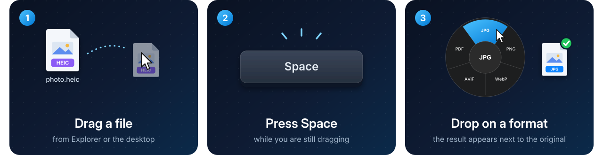
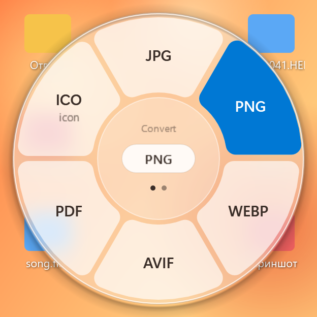
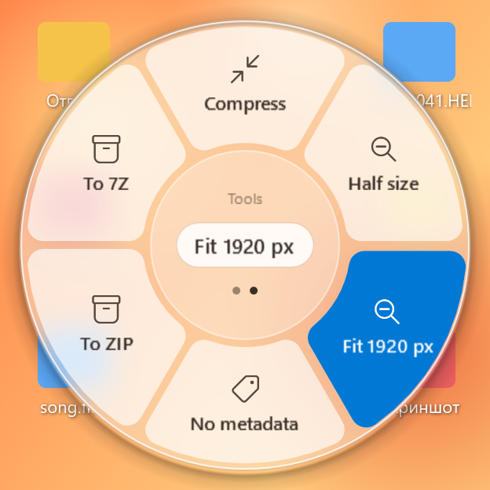
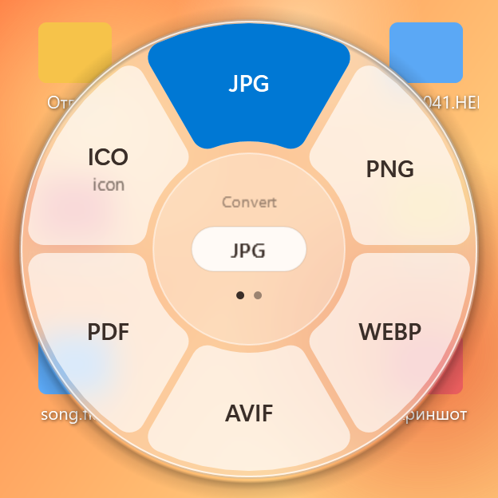
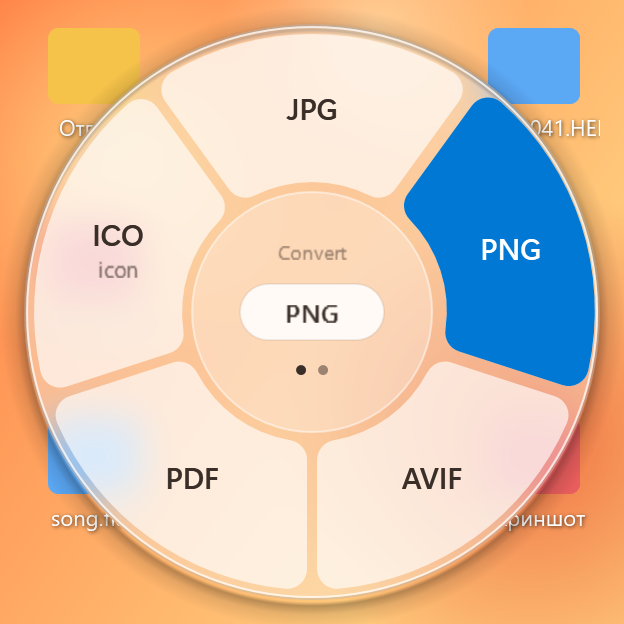
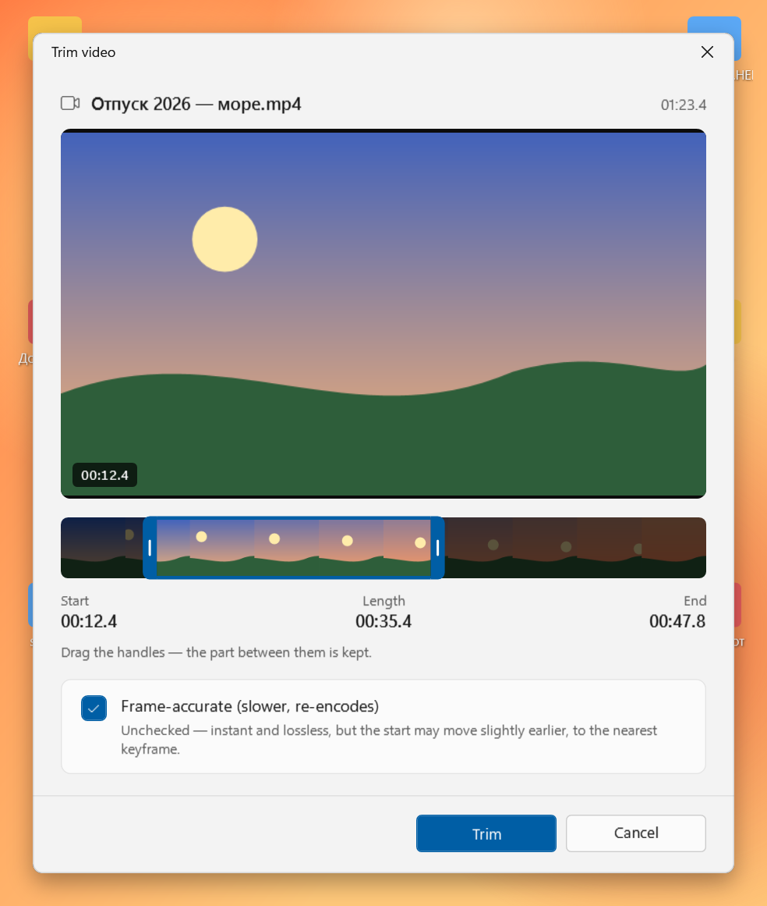
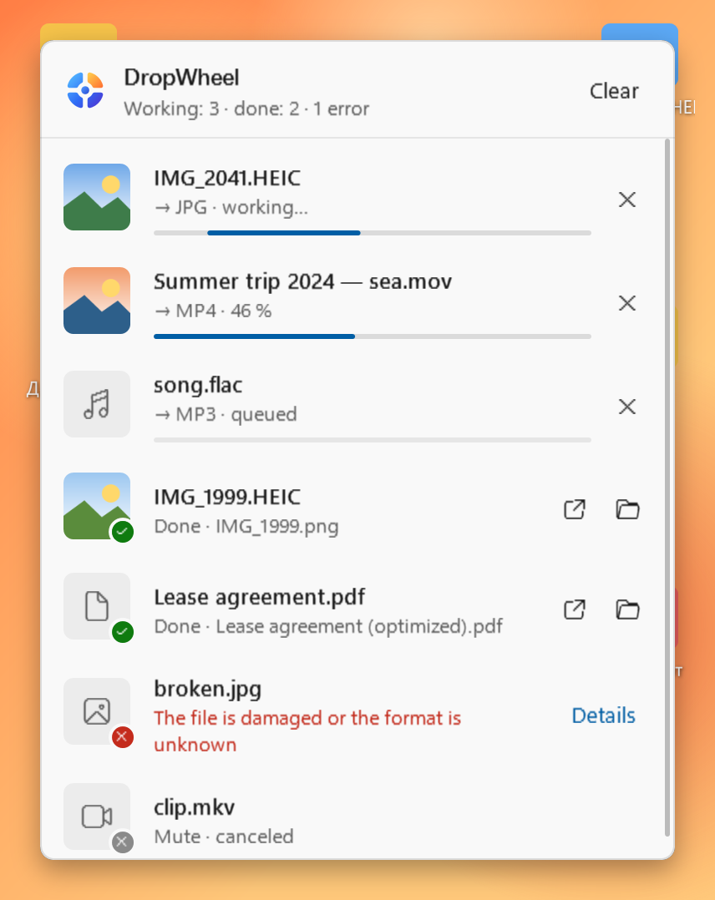
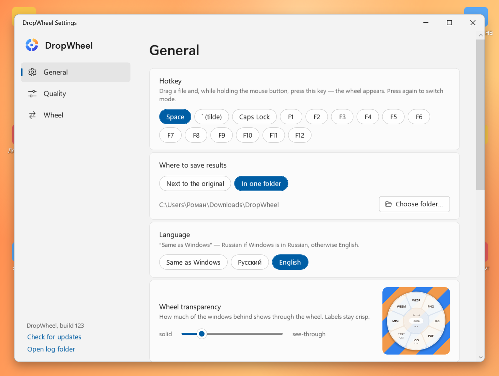
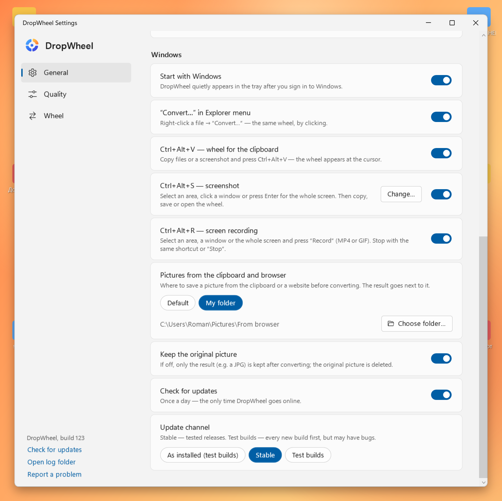
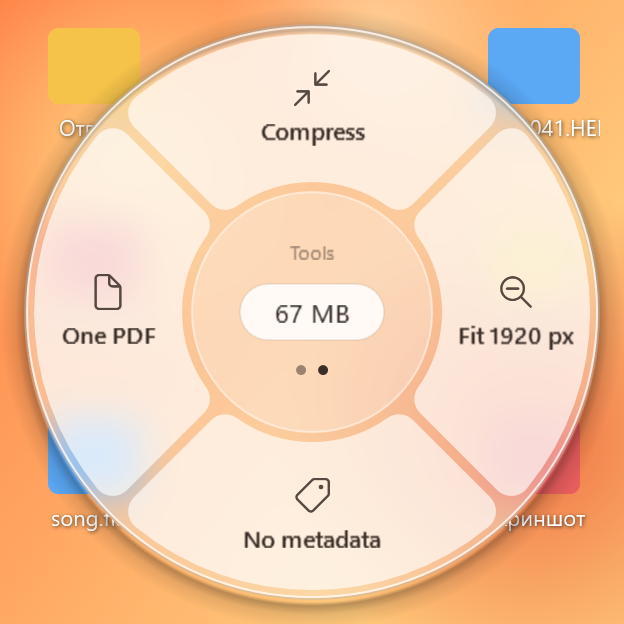

<p align="center">
  
</p>

<p align="center">
  <b>English</b> · <a href="README.ru.md">Русский</a>
</p>

<p align="center">
  <b>DropWheel</b> is a free, offline file converter for Windows that lives in your tray:<br>
  drag a file, press <kbd>Space</kbd>, drop it on a format — the converted file appears right next to the original.<br>
  Works for whole folders and for pictures dragged straight out of your browser, too.
</p>

<p align="center">
  <a href="https://github.com/Luchano55/dropwheel/actions/workflows/build.yml"></a>
  <a href="https://github.com/Luchano55/dropwheel/releases/latest"></a>
  <a href="https://github.com/Luchano55/dropwheel/releases/tag/dev-build"></a>
  <a href="#install"></a>
  <a href="https://dotnet.microsoft.com/download/dotnet/8.0"></a>
  <a href="LICENSE"></a>
  <a href="#privacy"></a>
  <a href="#privacy"></a>
</p>

<p align="center">
  <a href="https://github.com/Luchano55/dropwheel/releases/latest"></a>
</p>

<p align="center">
  <a href="#how-it-works">How it works</a> ·
  <a href="#features">Features</a> ·
  <a href="#screenshots">Screenshots</a> ·
  <a href="#supported-formats">Formats</a> ·
  <a href="#install">Install</a> ·
  <a href="#usage">Usage</a> ·
  <a href="#faq">FAQ</a> ·
  <a href="#roadmap">Roadmap</a>
</p>

<p align="center">
  <br>
  <sub>Real recording on Windows (automated demo): a script moves the mouse on a GitHub Actions machine with Windows Server 2025.</sub>
</p>

## How it works

<p align="center">
  
</p>

1. **Drag** any file — from Explorer, the desktop, or a folder window. Keep holding the mouse button.
2. **Press <kbd>Space</kbd>.** A wheel of formats pops up right under your cursor. Press <kbd>Space</kbd> again to switch between **Convert** and **Tools**; <kbd>Esc</kbd> closes it.
3. **Drop** the file on a petal. That's it — `photo.heic` becomes `photo.jpg` in the same folder, and a notification with a preview tells you when it's done.

Not a fan of drag-and-drop? Right-click a file → **Convert…** in the Explorer menu opens the same wheel — just click a petal.

The same three steps work for a **whole folder** (`Vacation` → `Vacation (JPG)`), for a **picture dragged out of Chrome, Edge or Firefox**, and for whatever you've copied: <kbd>Ctrl</kbd>+<kbd>Alt</kbd>+<kbd>V</kbd> opens the wheel for the clipboard.

## Features

<table>
  <tr>
    <td width="33%" valign="top">
      <h3>🎯 Right under your cursor</h3>
      No app window, no “Save as” dialogs. A glass wheel appears where you are already dragging, in your Windows light/dark theme and accent colour.
    </td>
    <td width="33%" valign="top">
      <h3>✈️ 100% offline</h3>
      Every conversion runs on your PC with bundled ffmpeg, ImageMagick, qpdf, poppler and 7-Zip. Nothing is uploaded — works on a plane.
    </td>
    <td width="33%" valign="top">
      <h3>🛡️ Originals stay untouched</h3>
      The source file is never modified or deleted. Name already taken? You get <code>photo (1).jpg</code>.
    </td>
  </tr>
  <tr>
    <td width="33%" valign="top">
      <h3>📄 Office documents</h3>
      Word, Excel and PowerPoint through your installed Microsoft Office — pre-warmed in the background, so it's fast. Every Office format needs an activated (licensed) Office. No Office, or Office not working? DOCX → PDF, TXT, HTML, Markdown and XLSX → CSV still work.
    </td>
    <td width="33%" valign="top">
      <h3>🔎 Text from pictures</h3>
      OCR with the recognition engine built into Windows: a screenshot or a scan becomes a <code>.txt</code>. PDF → text, too.
    </td>
    <td width="33%" valign="top">
      <h3>🗜️ Archives</h3>
      Pack into ZIP or 7Z; extract ZIP, 7Z, RAR, TAR, GZ, BZ2, XZ — straight into a folder named after the archive.
    </td>
  </tr>
  <tr>
    <td width="33%" valign="top">
      <h3>📚 Many files at once</h3>
      Select several files: convert them all, merge PDFs, put photos into one PDF, or pack everything into a single archive. Or copy them and press <kbd>Ctrl</kbd>+<kbd>Alt</kbd>+<kbd>V</kbd> — works for screenshots too.
    </td>
    <td width="33%" valign="top">
      <h3>⚡ Quiet background queue</h3>
      Up to two jobs in parallel, a Windows 11-style jobs flyout in the tray, a notification with a preview, <i>Open</i> and <i>Show in folder</i>.
    </td>
    <td width="33%" valign="top">
      <h3>🖱️ Explorer integration</h3>
      “Convert…” in the right-click menu opens the same wheel, for one file or a whole selection. Per-user, no admin rights.
    </td>
  </tr>
  <tr>
    <td width="33%" valign="top">
      <h3>📁 Whole folders</h3>
      Right-click a folder → <i>Convert…</i>, or drag it and press <kbd>Space</kbd>. Up to 1000 files, subfolders included; results land in <code>Vacation (JPG)</code> next to it, with one notification for the lot.
    </td>
    <td width="33%" valign="top">
      <h3>🌐 Pictures from the browser</h3>
      Drag an image off a web page in Chrome, Edge or Firefox and press <kbd>Space</kbd>. No “Save image as…” first — and still offline: DropWheel takes the picture the browser hands over, it never downloads anything.
    </td>
    <td width="33%" valign="top">
      <h3>✂️ Video trimming</h3>
      <i>Tools → Trim…</i> opens a small window with a frame preview, a thumbnail strip and two handles. Instant and lossless by default, frame-accurate when you need it.
    </td>
  </tr>
  <tr>
    <td width="33%" valign="top">
      <h3>📦 Installer or zip, updates itself</h3>
      A per-user installer without admin rights, or just unzip and run — no .NET to install. New versions arrive with one click in the tray menu; stable releases or every test build — your choice.
    </td>
    <td width="33%" valign="top">
      <h3>🔤 Any file name, two languages</h3>
      Cyrillic, spaces, long paths — <code>Мои фото\тест 1.heic</code> just works. Interface in English and Russian, following your Windows language.
    </td>
    <td width="33%" valign="top">
      <h3>💸 Free &amp; open source</h3>
      MIT-licensed. No ads, no trial, no account, no limits.
    </td>
  </tr>
  <tr>
    <td width="33%" valign="top">
      <h3>📸 Screenshots</h3>
      <kbd>Ctrl</kbd>+<kbd>Alt</kbd>+<kbd>S</kbd>: select an area, click a window or take the whole screen — multiple monitors, any scaling — then <i>Copy</i>, <i>Save</i>, open the <i>Wheel</i> or grab the <i>Text</i>. Lightweight: nothing stays in memory afterwards.
    </td>
  </tr>
</table>

## Screenshots

<table>
  <tr>
    <td align="center" width="50%">
      <br>
      <sub><b>Photo → Convert</b> — the petal under the cursor lights up in your accent colour</sub>
    </td>
    <td align="center" width="50%">
      <br>
      <sub><b>Photo → Tools</b> — press <kbd>Space</kbd> again to switch</sub>
    </td>
  </tr>
  <tr>
    <td align="center" width="50%">
      <br>
      <sub><b>Video</b> — MP4, WebM, GIF or just the audio as MP3</sub>
    </td>
    <td align="center" width="50%">
      <br>
      <sub><b>PDF</b> — pages as images, the text, or an editable DOCX</sub>
    </td>
  </tr>
  <tr>
    <td align="center" width="50%">
      <br>
      <sub><b>A whole folder</b> — <i>Convert…</i> on <code>Vacation</code>: formats for the photos inside, results in <code>Vacation (JPG)</code></sub>
    </td>
    <td align="center" width="50%">
      <br>
      <sub><b>A picture from the browser</b> — drag a WebP off a web page, press <kbd>Space</kbd>, drop it on PNG</sub>
    </td>
  </tr>
  <tr>
    <td align="center" width="50%">
      <br>
      <sub><b>Trim video</b> — drag the handles; the part between them is kept</sub>
    </td>
    <td align="center" width="50%">
      <br>
      <sub><b>Jobs flyout</b> — click the tray icon: progress, <i>Cancel</i>, <i>Open</i>, <i>Show in folder</i></sub>
    </td>
  </tr>
  <tr>
    <td align="center" colspan="2">
      <br>
      <sub><b>Settings</b> — hotkey, output folder, language, wheel transparency with a live preview; further down — clipboard and browser pictures, autostart, update channel</sub>
    </td>
  </tr>
  <tr>
    <td align="center" colspan="2">
      <br>
      <sub><b>Settings, further down</b> — start with Windows, the Explorer menu, the folder for clipboard and browser pictures, <i>Keep the original picture</i>, the update channel</sub>
    </td>
  </tr>
</table>

<sub>Interface: English and Russian (follows the Windows language; switch in Settings). The video and PDF wheels above show the Russian interface — format names are the same in both.</sub>

## Supported formats

The wheel only offers what makes sense for the file you are dragging: a `.jpg` never gets “→ JPG”, a video never gets “→ PDF”. With several files of different types you get the operations they have in common. Result names below are as in the English interface; in the Russian interface the tags are Russian (`photo (сжато).jpg`).

**Folders** get the operations for the kind of file they mostly contain (a folder of photos → the photo wheel). The operation is applied to every file inside that it fits, subfolders included; results go to a new folder next to it — `Vacation` → `Vacation (JPG)`, `Vacation (compressed)` — with the same subfolders. Files already in the target format are copied as they are, unsuitable files are skipped and counted in the notification. *One PDF* and *Merge* make a single file named after the folder (`Vacation (all).pdf`). ZIP and 7Z aren't offered for folders.

**Needs:** — = nothing, works on any PC right after unzipping · **Office** = Microsoft Office 2013 or newer installed · **Edge** = Edge WebView2 Runtime, already part of Windows 10/11 · **OCR** = a Windows OCR language (see [Known limitations](#known-limitations)). Office, Edge and OCR operations are done by the tray app, not by `dropwheel-cli`.

<details open>
<summary><b>🖼️ Images</b> — JPG, PNG, WebP, HEIC, AVIF, BMP, TIFF, GIF · in: also SVG, PSD, camera RAW · out: also ICO, OCR text, GIF → video</summary>

<br>

**Input:** JPG / JPEG / JFIF, PNG, WebP, HEIC / HEIF (iPhone photos), AVIF, BMP, TIFF, GIF — plus read-only **SVG**, **PSD** (the flattened image) and camera **RAW**: CR2, CR3 (Canon), NEF (Nikon), ARW (Sony), DNG, RAF (Fujifilm), ORF (Olympus), RW2 (Panasonic).

| | Operation | What you get | Needs | CLI id |
|---|---|---|---|---|
| Convert | → JPG · PNG · WebP · AVIF | same picture, new format (EXIF rotation applied, transparency on white for JPG) | — | `to-jpg` `to-png` `to-webp` `to-avif` |
| Convert | → PDF | a one-page PDF | — | `to-pdf` |
| Convert | → ICO | a Windows icon: the picture centred in a transparent square, sizes 256…16 px | — | `img-ico` |
| Convert | → Text (OCR) | the recognised text in `scan.txt` (from JPG, PNG, BMP, TIFF) | **OCR** | `img-ocr` |
| Convert | GIF → MP4 · WebM | an animated GIF as a real video (H.264 / VP9, no sound) — much smaller | — | `gif-to-mp4` `gif-to-webm` |
| Tool | Compress | JPG/WebP at quality 80 → `photo (compressed).jpg` | — | `img-compress` |
| Tool | Downscale ×2 | half the width and height → `photo (50%).jpg` | — | `img-half` |
| Tool | Fit to 1920 px | longest side ≤ 1920 px, small pictures are left as is → `photo (1920).jpg` | — | `img-1920` |
| Tool | Strip metadata | removes EXIF, GPS location, camera info → `photo (no metadata).jpg` | — | `img-strip` |
| Tool | Crop… | a window with a crop frame (8 handles) and aspect presets Free / 1:1 / 4:3 / 16:9 / Original → `photo (cropped).jpg`, same format; transparency kept. One picture at a time. CLI: `--crop 800x600+100+50` | — | `img-crop` |
| Tool | Beautify… | a window with a live preview: rounded corners, a soft shadow and padding on a background (3 gradients, white, grey, dark or transparent) → `photo (styled).png` — handy for screenshots. *Copy* puts the picture into the clipboard without saving. One picture at a time. CLI: `--style "bg=sunset;pad=8;radius=12;shadow=1"` | — | `img-beautify` |
| Tool | One PDF (2+ images) | every image becomes a page → `photo (all).pdf` | — | `images-to-pdf` |

Tools keep the format for ordinary pictures; HEIC, AVIF, SVG, PSD and RAW come out as JPG.

</details>

<details>
<summary><b>🎬 Video</b> — MP4, MOV, MKV, WebM, AVI · subtitles → SRT · rotate, frames, poster</summary>

<br>

**Input:** MP4 / M4V, MOV, MKV, WebM, AVI

| | Operation | What you get | Needs | CLI id |
|---|---|---|---|---|
| Convert | → MP4 | H.264 + AAC, plays everywhere, fast start in browsers | — | `to-mp4` |
| Convert | → WebM | VP9 + Opus | — | `to-webm` |
| Convert | → GIF | 15 fps, up to 640 px wide, optimised palette | — | `to-gif` |
| Convert | → MP3 | just the soundtrack | — | `video-to-mp3` |
| Convert | → JPG (frame) | a poster: the frame at 1 s (the last one for shorter clips) → `clip (frame).jpg` | — | `video-poster` |
| Tool | Compress | H.264 at CRF 28 → `clip (compressed).mp4` | — | `video-compress` |
| Tool | 720p | short side ≤ 720 px, vertical videos stay vertical → `clip (720p).mp4` | — | `video-720p` |
| Tool | Mute | removes the audio without re-encoding → `clip (muted).mp4` | — | `video-mute` |
| Tool | Rotate ↻ | 90° clockwise, re-encoded to H.264 + AAC → `clip (rotated).mp4` | — | `video-rotate-cw` |
| Tool | Trim… | a window with start/end handles over a thumbnail strip → `clip (trimmed).mp4`, same container, instant and lossless (starts at a keyframe); “Frame-accurate” re-encodes to H.264 + AAC. One video at a time. CLI: `--start 0:05 --end 0:12 [--exact]` | — | `video-trim` |
| Tool | Trim… → GIF | in the Trim window choose “Result: GIF” — the selected part as an animated GIF (15 fps, up to 640 px wide, no sound) → `clip (clip).gif`; a hint warns when the part is over 30 s. CLI: `video-trim --start 0:05 --end 0:12 --gif` | — | `video-trim-gif` |
| Tool | Frames | one JPG per second (up to 300) → folder `clip (frames)` with `frame-001.jpg`… | — | `video-frames` |
| Tool | Subtitles SRT | the first subtitle track → `clip.srt` next to the video (players pick it up automatically); picture subtitles from DVD/Blu-ray aren't supported | — | `video-subs` |

</details>

<details>
<summary><b>🎵 Audio</b> — MP3, M4A, WAV, FLAC, OGG, Opus</summary>

<br>

**Input:** MP3, M4A, WAV, FLAC, OGG, Opus

| | Operation | What you get | Needs | CLI id |
|---|---|---|---|---|
| Convert | → MP3 · M4A · WAV · FLAC · OGG | MP3 at 192 kbps, the rest with sensible defaults | — | `to-mp3` `to-m4a` `to-wav` `to-flac` `to-ogg` |
| Tool | Normalize loudness | EBU R128 loudness normalisation (−16 LUFS), same format → `song (normalized).flac` | — | `audio-normalize` |

</details>

<details>
<summary><b>📕 PDF</b> — pages → PNG/JPG, → TXT, → DOCX · merge, split, optimize, rotate, password</summary>

<br>

| | Operation | What you get | Needs | CLI id |
|---|---|---|---|---|
| Convert | → PNG / JPG (pages) | every page as an image (150 dpi) in a folder `report (pages)` | — | `pdf-to-png` `pdf-to-jpg` |
| Convert | → TXT | the text with its layout (columns, indents); a scan has no text layer — you get a clear message instead of an empty file | — | `pdf-to-txt` |
| Convert | → DOCX | an editable Word document — Word rebuilds the PDF itself | **Office** (Word) | `pdf-to-docx` |
| Convert | → Markdown | Word rebuilds the PDF, then headings, lists, bold and tables become Markdown | **Office** (Word) — slow for long PDFs | `pdf-to-md` |
| Convert | → MD (fast) | instant: the text in reading order as a `.md`, no headings or tables | — | `pdf-to-md-fast` |
| Tool | Merge (2+ PDFs) | one PDF, in the order the files came → `report (merged).pdf` | — | `pdf-merge` |
| Tool | Split | one PDF per page in a folder `report (split)` | — | `pdf-split` |
| Tool | Optimize | lossless: object streams + maximum Flate compression → `report (optimized).pdf` | — | `pdf-optimize` |
| Tool | Rotate ↻ | all pages 90° clockwise, nothing re-encoded → `report (rotated).pdf` | — | `pdf-rotate` |
| Tool | Protect… | asks for a password (twice) and adds an open password, AES-256 → `report (protected).pdf`. The password is never saved or logged. CLI: `--password <password>` | — | `pdf-protect` |
| Tool | Remove password… | asks for the password and makes a copy without it → `report (unlocked).pdf`; a wrong password gives “Wrong password”. CLI: `--password <password>` | — | `pdf-unlock` |

</details>

<details>
<summary><b>📄 Office documents</b> — Word, Excel, PowerPoint · with Microsoft Office or without</summary>

<br>

**With Microsoft Office** (2013 or newer) Office itself does the conversion — exactly like *Save as*. DropWheel starts its own invisible Office instance and never touches your open documents; files are opened read-only, macros are disabled, password-protected documents are reported instead of asking. Office is **pre-warmed**: as soon as the wheel shows an Office format, Word, Excel or PowerPoint starts in the background while you aim, so the drop is quick (cold start ~3–5 s, then ~1 s per document). It closes after 5 idle minutes. Word, Excel and PowerPoint are detected separately — only what you have shows up.

> **Full Office support needs an activated, licensed Microsoft Office.** If Office is installed but not activated (or stuck on a first-run dialog), DropWheel falls back to the Office-free conversions below; DOC / RTF / ODT, XLS / ODS and all PowerPoint conversions then aren't available. DOC is hidden on the wheel by default — show it in Settings → Wheel.

**Without Office** built-in libraries and Edge cover the common cases.

| Input | With Microsoft Office | Without Office | CLI id |
|---|---|---|---|
| **Word:** DOC, DOCX, DOCM, RTF, ODT | → PDF · DOCX · DOC · ODT · RTF · TXT | DOCX / DOCM only: → **PDF** through Edge, “almost like Word” (**Edge**) · → **TXT** | `word-to-pdf` `word-to-docx` `word-to-doc` `word-to-odt` `word-to-rtf` `word-to-txt` |
| **Word:** DOCX, DOCM | → HTML (self-contained, images inside) · Markdown — built-in libraries either way | same | `word-to-html` `word-to-md` |
| **Excel:** XLS, XLSX, XLSM, ODS, CSV | → PDF (whole workbook) · XLSX · XLS · CSV (first sheet, UTF-8) · ODS | XLSX / XLSM / XLS → **CSV** (first sheet, values as shown in Excel, UTF-8 that Excel opens without garbled letters) | `excel-to-pdf` `excel-to-xlsx` `excel-to-xls` `excel-to-csv` `excel-to-ods` |
| **CSV** | → XLSX: separator (`;` `,` tab) and encoding (UTF-8 / Windows-1251) detected, numbers and dates become real cells, codes like `007` stay text, formulas are never created — built-in either way | same | `csv-to-xlsx` |
| **PowerPoint:** PPT, PPTX, PPTM, ODP | → PDF · PPTX · PPT · ODP · Slides PNG (folder `deck (slides)`, 1920 px wide) | — | `ppt-to-pdf` `ppt-to-pptx` `ppt-to-ppt` `ppt-to-odp` `ppt-to-png` |
| **PDF** | → DOCX · Markdown (see PDF above) | “MD (fast)” — plain text | `pdf-to-docx` `pdf-to-md-fast` |

</details>

<details>
<summary><b>📝 Text, Markdown, HTML</b> — → PDF, Markdown → HTML, fix encoding → UTF-8</summary>

<br>

| | Input | What you get | Needs | CLI id |
|---|---|---|---|---|
| Convert | TXT · Markdown · HTML | → **PDF** (A4), printed by Edge without browser headers; Markdown with tables, code and pictures | **Edge** | `text-to-pdf` |
| Convert | Markdown (`.md`, `.markdown`) | → **HTML**: a styled page with tables, task lists, footnotes | — | `md-to-html` |
| Tool | TXT · CSV · SRT · MD · INI · LOG · XML · JSON | **To UTF-8** — fixes “garbled letters”: Windows-1251, DOS-866 or UTF-16 → UTF-8 → `notes (UTF-8).txt` (a file that is already UTF-8 is left alone) | — | `text-to-utf8` |

</details>

<details>
<summary><b>🗜️ Archives</b> — ZIP built in · 7Z, RAR, TAR, GZ, BZ2, XZ via 7-Zip · pack to ZIP / 7Z</summary>

<br>

| | Operation | What you get | Needs | CLI id |
|---|---|---|---|---|
| Tool | Pack to ZIP (any files) | one file → `photo.zip`; several files → one archive named after their folder | — (built in) | `zip-pack` |
| Tool | Pack to 7Z (any files) | the same, as a 7Z archive | — (bundled 7-Zip) | `pack-7z` |
| Tool | Extract ZIP | into a folder named after the archive; Cyrillic names from old Windows archivers are read correctly; archives with paths outside the folder (Zip Slip) are refused | — (built in) | `zip-extract` |
| Tool | Extract 7Z · RAR · TAR · GZ · TGZ · BZ2 · XZ | into a folder named after the archive; `.tar.gz` goes straight to the files | — (bundled 7-Zip) | `archive-extract` |

Password-protected archives aren't supported — you get a clear message.

</details>

## Install

### Installer (recommended)

1. Download **`DropWheel-Setup-<version>.exe`** from the [latest release](https://github.com/Luchano55/dropwheel/releases/latest).
2. Run it. No admin rights needed: DropWheel installs for your user only, into `%LocalAppData%\Programs\DropWheel`, and adds a Start menu shortcut. Optional: a desktop shortcut and *Start with Windows*.
3. DropWheel starts right away — a ring icon appears in the tray (it may hide under the <kbd>^</kbd> arrow next to the clock). Drag a file and press <kbd>Space</kbd>.

**Uninstall:** *Settings → Apps → DropWheel → Uninstall* (or *Add or remove programs*). This closes DropWheel and removes the Explorer menu entry and autostart. Your settings in `%AppData%\DropWheel` are kept — delete that folder if you don't need them.

### Portable zip

1. Download **`DropWheel-win-x64.zip`** from the same [release](https://github.com/Luchano55/dropwheel/releases/latest). The full archive (app + tools) is only needed for the first install.
2. Unzip it to any folder **you can write to**, for example `C:\DropWheel` or a folder in your user profile — **not** `C:\Program Files`: self-update replaces files in this folder. Keep the `tools` folder next to `DropWheel.exe` — that's where the converters live.
3. Run **`DropWheel.exe`**.

To remove the portable version: right-click the tray icon → untick **“Convert…” in Explorer menu** → **Exit**. Then delete the folder and, if you like, `%AppData%\DropWheel` (settings and logs).

### winget (coming soon)

```
winget install Luchano55.DropWheel
```

The package `Luchano55.DropWheel` has been submitted to the Windows Package Manager catalog and is waiting for review — the command will work once it's accepted. Until then, use the installer above.

### Stable releases and test builds

- **Stable** — releases tagged `vX.Y.Z` ([latest release](https://github.com/Luchano55/dropwheel/releases/latest)), with release notes from [`docs/CHANGELOG.md`](docs/CHANGELOG.md).
- **Test builds** — every build from `main`, in the [`dev-build`](https://github.com/Luchano55/dropwheel/releases/tag/dev-build) pre-release (installer and zips too). Newer, but less tested.

The installed app follows the channel it came from; switch any time in *Settings → General → Update channel*.

> [!NOTE]
> **“Windows protected your PC”?** DropWheel is a personal project and the build isn't code-signed, so Microsoft Defender SmartScreen warns about it. Click **More info → Run anyway**. Every build is made by [GitHub Actions](https://github.com/Luchano55/dropwheel/actions/workflows/build.yml) straight from the source code in this repository.

**Updates are automatic after that** (installer and zip alike): when a new build is out, the tray menu shows **Update to build N**. One click — DropWheel downloads only the app part (~100 MB; the tools only if they changed), verifies it with SHA-256, waits for running jobs to finish and restarts itself.

**Requirements:** Windows 10 (1809 or newer) or Windows 11, 64-bit. Nothing else — .NET is built in. Optional: Microsoft Office 2013+ for the Office conversions; a Windows OCR language for text recognition.

## Usage

### 🎡 The wheel: drag + <kbd>Space</kbd>

| You do | DropWheel does |
|---|---|
| Drag a file and press <kbd>Space</kbd> | shows the wheel under the cursor; the pill in the centre shows the file size |
| Press <kbd>Space</kbd> again | switches **Convert** ↔ **Tools** |
| Hover a petal | it lights up and its name appears in the centre |
| Drop on a petal | converts; the result appears next to the original |
| Drop in the centre, press <kbd>Esc</kbd> or release outside | cancels, nothing happens |

<kbd>Space</kbd> is only intercepted while you are dragging something — the rest of the time it types spaces and pauses videos as usual.

### 🖱️ Explorer: “Convert…”

Right-click one or more files → **Convert…** → the same wheel opens at the cursor, in click mode:

| You do | DropWheel does |
|---|---|
| Click a petal | converts |
| <kbd>Tab</kbd> or right click | switches **Convert** ↔ **Tools** |
| Arrow keys or mouse wheel, then <kbd>Enter</kbd> | picks a petal from the keyboard |
| <kbd>Esc</kbd> or click outside | closes the wheel |

On Windows 11 the item is under **Show more options** (or press <kbd>Shift</kbd>+<kbd>F10</kbd>). If DropWheel isn't running, it starts automatically.

### 📁 Whole folders

Right-click a folder → **Convert…** (or drag the folder and press <kbd>Space</kbd>). The wheel shows the operations for the kind of file the folder mostly holds — photos, videos, PDFs…

| You do | DropWheel does |
|---|---|
| Pick **JPG** for `Vacation` | creates `Vacation (JPG)` next to it, with the same subfolders: `Vacation\2023\a.heic` → `Vacation (JPG)\2023\a.jpg` |
| Pick a tool, e.g. **Compress** | `Vacation (compressed)`; the files inside keep their names — the tag is already in the folder name |
| Pick **One PDF** or **Merge** | one file named after the folder: `Vacation (all).pdf`, `Documents (merged).pdf` |



Files that are already in the target format are copied, so `Vacation (JPG)` holds all your photos, not only the former HEICs. Files the operation can't handle are skipped; hidden and system files (`desktop.ini`, `Thumbs.db`) are ignored. You get **one** notification for the whole folder — how many files are done, skipped or failed — with *Open* for the result folder. Up to 1000 files at a time; for a bigger folder DropWheel asks you to pick a smaller one. With *In one folder* in the settings, `Vacation (JPG)` goes there.

<br clear="right">

### 🌐 Pictures from the browser

Drag a picture off a web page in **Chrome, Edge or Firefox**, press <kbd>Space</kbd> and drop it on a format — just like a file. The picture is first saved to the same folder as clipboard pictures (`Pictures\DropWheel` by default) under its name from the website, and the result appears next to it.

- The format is recognised from the picture itself: plenty of sites serve WebP under a `.jpg` name — DropWheel sees that it's WebP and saves it as `.webp`.
- **Nothing is downloaded.** DropWheel uses the picture data the browser hands over while you drag. If the browser only gives a link (a background image, a link to a picture), the wheel says so — save the picture and drag the file instead.
- Dragging text or a link to a page doesn't bring up the wheel.

### ✂️ Trimming a video

Drag a video → **Tools** → **Trim…** (it's on the Explorer-menu and clipboard wheels too). A window opens:

- the frame at the handle you are moving, a strip of thumbnails and two handles — **start** and **end**; start, length and end times are shown below;
- <kbd>←</kbd>/<kbd>→</kbd> move a handle by 0.1 s, with <kbd>Shift</kbd> by 1 s; <kbd>Home</kbd>/<kbd>End</kbd>; <kbd>Tab</kbd> switches handles; <kbd>Enter</kbd> trims, <kbd>Esc</kbd> cancels.

By default the cut is **instant and lossless** — `clip (trimmed).mp4`, same format and quality; the start snaps to the nearest keyframe, so the clip may begin a fraction of a second earlier. Tick **Frame-accurate** to start exactly on the chosen frame: this re-encodes to H.264 + AAC (`.mp4`) and takes longer. One video at a time.

### 📋 From the clipboard: <kbd>Ctrl</kbd>+<kbd>Alt</kbd>+<kbd>V</kbd>

Copy files in Explorer (<kbd>Ctrl</kbd>+<kbd>C</kbd>) or take a screenshot (<kbd>Win</kbd>+<kbd>Shift</kbd>+<kbd>S</kbd>, “Copy image” in a browser), then press <kbd>Ctrl</kbd>+<kbd>Alt</kbd>+<kbd>V</kbd> — or right-click the tray icon → **From clipboard…**. The wheel opens at the cursor: for copied files — the same as **Convert…**; a picture is first saved as `Clipboard 2026-10-22 10-31-05.png` in `Pictures\DropWheel` (or your shared output folder), then you pick JPG, WebP, PDF, ICO, text (OCR)… Only text in the clipboard → a short hint. In *Settings → General → Pictures from the clipboard and browser* you can choose your own folder for these pictures and turn off **Keep the original picture** — then only the result (say, the JPG) stays, and the intermediate PNG is deleted after a successful conversion. The shortcut can be turned off in the settings; if another program already uses it, DropWheel works without it (the tray item stays). Copied folders aren't picked up from the clipboard — use **Convert…** on the folder instead.

### 📸 Screenshots: <kbd>Ctrl</kbd>+<kbd>Alt</kbd>+<kbd>S</kbd>

Press <kbd>Ctrl</kbd>+<kbd>Alt</kbd>+<kbd>S</kbd> or right-click the tray icon → **Screenshot**. The screen freezes and dims:

- **drag** in any direction to select an area (its size in pixels, e.g. `1280 × 720`, is shown next to it) — across monitors, too;
- **click** without dragging to take the window under the cursor (it is highlighted as you move), **double-click** or <kbd>Enter</kbd> for the whole monitor;
- <kbd>Esc</kbd> or a right click cancels.

A toolbar appears next to the selection: **Copy** (picture to the clipboard; <kbd>Ctrl</kbd>+<kbd>C</kbd> or <kbd>Enter</kbd>), **Save** (`Screenshot 2026-10-24 15-30-05.png` in `Pictures\DropWheel` or your folder for clipboard pictures; <kbd>Ctrl</kbd>+<kbd>S</kbd>), **Wheel** (save and open the wheel right away: JPG, WebP, PDF, Crop…, text…) and **Text** (recognise the text with the OCR built into Windows and copy it). The screenshot is kept in memory only while the screen is frozen and released right after. Turn the shortcut off in *Settings → General*; if another program already uses it, the tray item still works. Annotations, scrolling screenshots and screen recording are not there yet.

### 🔔 Tray, jobs and notifications

- **Left click** the tray icon — the jobs flyout: thumbnails, progress bars, *Cancel*; finished jobs have *Open* and *Show in folder*, failed ones the reason and *Details*.
- **Double click** — the settings window.
- **Right click** — *Jobs*, *From clipboard…*, *Settings…*, the Explorer menu on/off switch, *Open log*, *Check for updates*, *What's new*, *Exit*.
- While something is being converted, the icon shows an orange badge with the number of jobs.
- **Notifications** show a preview of the result with *Open* and *Show in folder*. Several files finished together → one notification “Done: N files”; a whole folder → one notification for the folder.

### 🔄 Updates

Once a day (and when you click *Check for updates*) DropWheel reads a small `version.json` from the [latest stable release](https://github.com/Luchano55/dropwheel/releases/latest) or, on the test channel, from the [`dev-build` release](https://github.com/Luchano55/dropwheel/releases/tag/dev-build) (*Settings → General → Update channel*). If there's a newer build, the tray menu offers **Update to build N** — nothing is downloaded until you click it. Don't want the check at all? Turn off *Check for updates* in the settings window. This is the only time DropWheel goes online.

After an update, a small **What's new** window lists the changes (it's built into the program — nothing is fetched); open it again any time from the tray menu → *What's new*.

### ⚙️ Settings

Double-click the tray icon (or right click → *Settings…*). Every change applies immediately — no OK button — and is saved to `%AppData%\DropWheel\settings.json`.

- **Hotkey** — <kbd>Space</kbd> (default), <kbd>Ё</kbd>/<kbd>`</kbd>, <kbd>Caps Lock</kbd>, <kbd>F1</kbd>–<kbd>F12</kbd> or any key of your own (*Custom…*: Tab, Num 5, F13… — not Ctrl/Shift/Alt/Win/Esc/Enter); works right away, no restart.
- **Language** — *Same as Windows* (default: Russian on a Russian Windows, English otherwise), *Русский* or *English*; switches right away.
- **Wheel transparency** — a slider from *solid* to *see-through* with a live preview; labels and the highlighted petal stay crisp.
- **Where results go** — next to the original, or all into one folder (default `Downloads\DropWheel`).
- **Quality** — JPG and WebP (50–100), video CRF (18–32, lower = better), MP3 bitrate (128–320 kbps). Applies to new jobs.
- **Pictures from the clipboard and browser** — the default folder or your own; **Keep the original picture** on or off.
- **Copy the result to the clipboard** (off by default) — a finished picture goes to the clipboard as a picture (paste it into a messenger or an editor), anything else — as a file (paste it in Explorer).
- **Start with Windows**, the Explorer menu item, <kbd>Ctrl</kbd>+<kbd>Alt</kbd>+<kbd>V</kbd> for the clipboard, the daily update check and the **update channel** (stable or test builds).
- **Your own wheel** — for each file type (photo, video, audio, PDF, Word, Excel, PowerPoint, text, archives, any file): reorder the formats (drag or ↑/↓), hide the ones you never use, with a live preview of the wheel. **Last choice first** puts the format you picked last time for that type on top.

### ⌨️ Command line

The archive also contains `dropwheel-cli.exe` for scripts and testing (everything except Office, Edge and OCR):

```bat
dropwheel-cli.exe list "C:\Мои фото\тест 1.heic"
dropwheel-cli.exe convert "C:\Мои фото\тест 1.heic" to-jpg
dropwheel-cli.exe convert "C:\Photos\Vacation" to-jpg
dropwheel-cli.exe convert clip.mp4 video-trim --start 0:05 --end 0:12
```

Messages follow the system language; `--lang en` or `--lang ru` picks one explicitly.

Or simply drag a file onto `try-dropwheel.cmd`: it lists the available operations and runs the one you type.

## Privacy

- **100% offline.** Every conversion happens on your PC. Your files are never uploaded anywhere — there is no server to upload them to.
- **No telemetry, no analytics, no account, no ads.**
- **The only thing DropWheel does online** is the update check: once a day (and when you click *Check for updates*) it reads a small `version.json` from this repository's [releases](https://github.com/Luchano55/dropwheel/releases/tag/dev-build). It sends no files and no personal data, and an update is only installed when you click it — the download is verified with SHA-256. Don't want even that? Set `"checkForUpdates": false` in `%AppData%\DropWheel\settings.json`.
- **Pictures dragged from a browser** are taken from what the browser hands over during the drag — DropWheel never fetches a link.
- Microsoft Office, Edge WebView2 and Windows OCR, when used, run locally too.
- Settings and logs stay on your computer in `%AppData%\DropWheel`. Logs contain file paths and error messages — have a quick look before attaching one to a bug report.

## Known limitations

- **Windows running as administrator.** Windows doesn't let normal apps interact with elevated windows (UIPI): dragging from an app that runs as administrator won't open the wheel. Drag from a normal window instead.
- **Office-free DOCX → PDF / HTML is an approximation.** Fonts, lists, tables, pictures, page size and margins are kept, but the browser breaks lines and pages, not Word — pages can shift by a line or two. Headers and footers, page numbers, footnotes, comments, text boxes, shapes, SmartArt, charts, old EMF/WMF pictures and columns aren't carried over. DOC, RTF, ODT, ODS and PowerPoint need Office. Need it exact? Use Office.
- **OCR needs a Windows OCR language.** It comes with a Windows display language, or add one in *Settings → Time & language → Language & region*. Without any, the “Text (OCR)” petal simply doesn't appear. OCR reads JPG, PNG, BMP and TIFF — convert other formats to PNG first.
- **Scanned PDFs have no text**, so PDF → TXT reports it: export the pages as PNG and use OCR.
- **Password-protected** archives and documents aren't supported.
- **From a browser — pictures only.** Dragging a picture works in Chrome, Edge and Firefox; other things on a page (videos, PDFs) aren't picked up — download them first. If the browser offers only a link to the picture, DropWheel shows a hint instead of downloading it.
- **Folders: up to 1000 files at a time**, and ZIP / 7Z aren't offered for folders (Windows' own *Send to → Compressed (zipped) folder* keeps the subfolders). Folders copied to the clipboard are ignored by <kbd>Ctrl</kbd>+<kbd>Alt</kbd>+<kbd>V</kbd>.
- **Trim** works on one video at a time; the instant mode starts at the nearest keyframe (tick *Frame-accurate* for an exact start). The trim window shows frames, it doesn't play the video.
- Log files are written in Russian (they are for bug reports, not for reading every day).

## FAQ

<details>
<summary><b>Is it really free?</b></summary>

Yes. DropWheel is MIT-licensed open source: no ads, no trial, no “pro” version, no limits.
</details>

<details>
<summary><b>Will it change or delete my original file?</b></summary>

Never. The result is written to a temporary file first and only then renamed, so a failed conversion leaves nothing half-done behind. If the name is taken, you get `photo (1).jpg`, `photo (2).jpg`, …
</details>

<details>
<summary><b>Where does the converted file go? What are the tags like “(compressed)”?</b></summary>

Right next to the original: `photo.heic` → `photo.jpg`. Tools keep the format, so they add a short tag to the name: `photo (compressed).jpg`, `clip (720p).mp4`, `clip (trimmed).mp4`, `song (normalized).flac`, `report (rotated).pdf`, `notes (UTF-8).txt`. Tags follow the interface language — in Russian it's `photo (сжато).jpg`. A whole folder goes to a sibling folder such as `Vacation (JPG)`. Want everything in one place? *Settings → General → Where to save results → In one folder*.
</details>

<details>
<summary><b>Do I need Microsoft Office?</b></summary>

No. Full Office conversions need an activated Microsoft Office; without it (or with an unactivated one) you still get DOCX → PDF / TXT / HTML / Markdown, XLSX / XLS → CSV, CSV → XLSX and TXT / Markdown / HTML → PDF. With Office you also get exact Word, Excel and PowerPoint conversions (DOC, RTF, ODT, ODS, PPT, PPTX, ODP, slides as PNG) and PDF → DOCX. DropWheel runs its own hidden Office instance and leaves your open documents alone; a pre-warmed Word or Excel uses roughly 100–200 MB of RAM until it closes after 5 idle minutes or when you exit DropWheel.
</details>

<details>
<summary><b>Is the interface available in English?</b></summary>

Yes. The interface is in Russian and English: it follows the Windows display language — Russian on a Russian Windows, English everywhere else. To switch, double-click the tray icon → *General* → *Language* (*Same as Windows* / *Русский* / *English*); the tray menu, the wheel and the windows change right away. Result names follow the language too: `photo (compressed).jpg` instead of `photo (compressed).jpg`. The command line uses the system language; add `--lang en` or `--lang ru` to choose.
</details>

<details>
<summary><b>The wheel doesn't appear when I press Space.</b></summary>

- Make sure DropWheel is running (ring icon in the tray).
- Press <kbd>Space</kbd> <i>while</i> you are still holding the mouse button and dragging the file.
- Dragging from a window that runs as administrator doesn't work (see <a href="#known-limitations">Known limitations</a>).
- From a browser, only pictures bring up the wheel — not text, page links or other downloads.
</details>

<details>
<summary><b>Space is busy in my workflow. Can I use another key?</b></summary>

Yes. Double-click the tray icon → *General* → *Hotkey*: <kbd>`</kbd> / <kbd>Ё</kbd>, <kbd>Caps Lock</kbd>, <kbd>F1</kbd>–<kbd>F12</kbd>, or *Custom…* and press any key you like. It works right away, no restart needed.
</details>

<details>
<summary><b>Can I convert a whole folder?</b></summary>

Yes — right-click the folder → *Convert…*, or drag it and press <kbd>Space</kbd>. The results go to a new folder next to it (`Vacation` → `Vacation (JPG)`) with the same subfolders; your folder stays as it was. Up to 1000 files at a time. See [Whole folders](#-whole-folders).
</details>

<details>
<summary><b>Does it download pictures from the internet?</b></summary>

No. When you drag a picture out of a browser, the browser itself hands over the picture data, and DropWheel saves exactly that. If all it gets is a link, you see a hint — nothing is fetched. The only network request DropWheel ever makes is the update check.
</details>

<details>
<summary><b>Does it start with Windows?</b></summary>

If you want it to: the installer offers *Start with Windows*, and you can switch it any time in *Settings → General → Start with Windows*.
</details>

<details>
<summary><b>How do I update? Which build do I have?</b></summary>

DropWheel checks for a new build once a day and offers *Update to build N* in the tray menu. Right-click the tray icon → *Check for updates* to check right now — it also tells you your current build number; the version and build are also shown at the bottom of the settings window. You can always run a newer installer over the installed version, or download the full archive again from <a href="https://github.com/Luchano55/dropwheel/releases">Releases</a> and unzip it over the old folder. Stable versions only or every test build — choose in *Settings → General → Update channel*.
</details>

<details>
<summary><b>Why is the download so big?</b></summary>

It bundles ffmpeg, ImageMagick, qpdf, poppler and 7-Zip so that everything works offline right after unzipping — no extra downloads, no PATH tweaking. Those tools are most of the size. Updates are smaller: only the app part is downloaded, the tools only when they change.
</details>

<details>
<summary><b>Something went wrong. How do I report it?</b></summary>

Right-click the tray icon → *Open log*, take the newest `.log` file and attach it to a <a href="https://github.com/Luchano55/dropwheel/issues/new/choose">bug report</a> together with your Windows version and DropWheel build number.
</details>

## Roadmap

**Done in 1.0:**

- [x] Conversion core: images, video, audio — ffmpeg + ImageMagick, background queue, safe file naming
- [x] Tray app, jobs flyout, notifications with preview
- [x] The wheel: drag + <kbd>Space</kbd>, Convert/Tools modes, multi-monitor and high-DPI aware, light/dark theme and accent colour, adjustable transparency
- [x] “Convert…” in the Explorer menu opens the same wheel in click mode
- [x] PDF: merge, split, rotate, lossless optimize, pages → images, → TXT
- [x] Office documents via installed Microsoft Office, pre-warmed in the background
- [x] Documents without Office: DOCX → PDF / TXT / HTML / Markdown, XLSX / XLS → CSV, CSV → XLSX, TXT / Markdown / HTML → PDF
- [x] OCR with the Windows recognition engine
- [x] Archives: ZIP built in; 7Z, RAR, TAR, GZ, BZ2, XZ via 7-Zip; pack to ZIP / 7Z
- [x] Icons (ICO), SVG / PSD / RAW input, GIF → MP4 / WebM, subtitles → SRT, text → UTF-8
- [x] Whole folders: Explorer menu or drag + <kbd>Space</kbd>, subfolders mirrored, one notification per folder
- [x] Pictures dragged from Chrome, Edge and Firefox — offline, nothing downloaded
- [x] Video: trim (lossless or frame-accurate), frames, poster, rotate
- [x] Clipboard wheel (<kbd>Ctrl</kbd>+<kbd>Alt</kbd>+<kbd>V</kbd>) for copied files and screenshots
- [x] Settings window: hotkey, output folder, quality, language, transparency, autostart, clipboard pictures, update channel; your own wheel (order, hidden formats, last choice first)
- [x] Interface in English and Russian (follows the Windows language; switch in Settings)
- [x] Installer without admin rights, version numbers, stable and test update channels; self-update verified with SHA-256
- [x] Automated demo recording and end-to-end test on a real Windows machine in CI
- [ ] winget package `Luchano55.DropWheel` — submitted, waiting for review

**Next:**

- [x] Pictures: crop with aspect presets (Free, 1:1, 4:3, 16:9, Original)
- [ ] Built-in editors: background removal, add a background (palette, padding, rounded corners, shadow), annotations
- [ ] A smaller download: a custom ffmpeg build with only what DropWheel needs

Have an idea? [Open a feature request](https://github.com/Luchano55/dropwheel/issues/new/choose).

## Build from source

You need the [.NET 8 SDK](https://dotnet.microsoft.com/download/dotnet/8.0).

```bash
git clone https://github.com/Luchano55/dropwheel.git
cd dropwheel
dotnet build
dotnet test
```

- The core and the CLI (`src/DropWheel.Core`, `src/DropWheel.Cli`) are cross-platform `net8.0` and are fully tested on Linux too — including the Office-free document libraries. The tray app `src/DropWheel` is WPF (`net8.0-windows`): it builds anywhere thanks to `EnableWindowsTargeting`, but runs only on Windows. Office, Edge and OCR tests run only on Windows (Office tests only where Office is installed).
- Integration tests need the real tools: `ffmpeg`, ImageMagick (`magick` or `convert`), `qpdf`, `pdftoppm` and `pdftotext` (poppler-utils), `7z` (7-Zip) in `PATH`, or the variables `DROPWHEEL_FFMPEG`, `DROPWHEEL_MAGICK`, `DROPWHEEL_QPDF`, `DROPWHEEL_PDFTOPPM`, `DROPWHEEL_PDFTOTEXT`, `DROPWHEEL_7Z`. Without them those tests are skipped. On Ubuntu: `sudo apt-get install ffmpeg imagemagick libheif-plugin-libde265 libheif-plugin-aomenc librsvg2-bin qpdf poppler-utils 7zip`.
- Windows builds of the tools: `./build/fetch-tools.ps1 -Destination tools` (PowerShell).
- Every push runs [`.github/workflows/build.yml`](.github/workflows/build.yml): tests on Linux and Windows, wheel and flyout screenshots, and a self-contained single-file build zipped with `tools/`. Working branches also get the automated demo: a script drives the real app on Windows, records the screen and checks that the results appeared. Builds from `main` are published to the [`dev-build`](https://github.com/Luchano55/dropwheel/releases/tag/dev-build) pre-release together with `version.json` for self-update; a tag `vX.Y.Z` makes a stable release with the Inno Setup installer (`packaging/installer/DropWheel.iss`) and winget manifests (`packaging/winget/`, see [`docs/winget.md`](docs/winget.md)). The version lives in `version.txt`.

```
src/DropWheel.Core/   conversion catalog, engines, document libraries, job queue, settings, updates, wheel geometry (no UI)
src/DropWheel.Cli/    dropwheel-cli.exe
src/DropWheel/        the WPF tray app: hooks, wheel window, Explorer menu, notifications, Office / Edge / OCR engines
tests/                xUnit tests (+ Windows-only tests: Office, Edge, OCR, screenshots)
build/                fetch-tools.ps1 — downloads ffmpeg, ImageMagick, qpdf, poppler, 7-Zip for Windows; demo/ — demo recording
tools-src/DemoDriver/ the robot that records the demo (not part of the app)
docs/                 spec, design decisions, manual test checklist
```

**Adding a format is one line:** operations are declared in [`OperationCatalog.cs`](src/DropWheel.Core/Conversions/OperationCatalog.cs) — id, label, input type, engine, argument template, output extension, fallback engine. Issues and pull requests are welcome!

## Credits

DropWheel is a thin, friendly layer over excellent open-source tools.

**Bundled tools** — separate programs in the `tools` folder; DropWheel runs them and doesn't modify them:

| Tool | Used for | License |
|---|---|---|
| [**FFmpeg**](https://ffmpeg.org) — GPL build by [BtbN/FFmpeg-Builds](https://github.com/BtbN/FFmpeg-Builds) | video, audio, GIF, subtitles | GPL v3 (source code at BtbN/FFmpeg-Builds and ffmpeg.org); license text in `tools/ffmpeg/LICENSE.txt` |
| [**ImageMagick**](https://imagemagick.org) 7 — official portable build | images, HEIC, AVIF, SVG, PSD, RAW, ICO, PDF from images | ImageMagick License (Apache-2.0 compatible) |
| [**qpdf**](https://github.com/qpdf/qpdf) — official build | PDF merge, split, optimize, rotate | Apache-2.0 |
| [**poppler**](https://poppler.freedesktop.org) (`pdftoppm`, `pdftotext`) — build by [oschwartz10612/poppler-windows](https://github.com/oschwartz10612/poppler-windows) | PDF pages → images, PDF → text | GPL-2.0 or later (source code at poppler.freedesktop.org) |
| [**7-Zip**](https://www.7-zip.org) (`7z.exe`, `7z.dll`) — official build by Igor Pavlov ([ip7z/7zip](https://github.com/ip7z/7zip)) | 7Z, RAR, TAR, GZ, BZ2, XZ; pack to 7Z | GNU LGPL-2.1 or later, parts BSD-3-Clause; the RAR decompression code is under the unRAR license restriction — it may not be used to recreate the RAR compression algorithm (DropWheel only extracts RAR). License text in `tools/7zip/License.txt`, source code at 7-zip.org |

**Libraries inside DropWheel:**

| Library | Used for | License |
|---|---|---|
| [DocumentFormat.OpenXml](https://github.com/dotnet/Open-XML-SDK) (Open XML SDK) | reading DOCX, writing XLSX | MIT |
| [Codeuctivity.OpenXmlPowerTools](https://github.com/Codeuctivity/OpenXmlPowerTools) | DOCX → HTML (and → PDF through Edge) | MIT |
| [SkiaSharp](https://github.com/mono/SkiaSharp) (used by OpenXmlPowerTools) | graphics | MIT; bundles Skia (BSD-3-Clause) |
| [ExcelDataReader](https://github.com/ExcelDataReader/ExcelDataReader) | reading XLSX / XLS | MIT |
| [ExcelNumberFormat](https://github.com/andersnm/ExcelNumberFormat) | numbers and dates as Excel shows them | MIT |
| [Markdig](https://github.com/xoofx/markdig) | Markdown → HTML | BSD-2-Clause |
| [Microsoft.Web.WebView2](https://www.nuget.org/packages/Microsoft.Web.WebView2) | printing to PDF through the Edge WebView2 Runtime that ships with Windows 10/11 | BSD-3-Clause |
| [Microsoft.Toolkit.Uwp.Notifications](https://github.com/CommunityToolkit/WindowsCommunityToolkit) | Windows notifications | MIT |

Built with [.NET 8](https://dotnet.microsoft.com) and WPF. Microsoft Office and Windows OCR are used only if they are on your PC; they are not part of the download. Artwork lettering is set in [Inter](https://rsms.me/inter/) (SIL OFL 1.1).

## License

**MIT** — see [`LICENSE`](LICENSE). The bundled tools and libraries keep their own licenses (see [Credits](#credits)).

<p align="center"><sub>Made with ☕ by <a href="https://github.com/Luchano55">Roman</a>. If DropWheel saves you a trip to an online converter, consider giving it a ⭐</sub></p>
