<p align="center">
  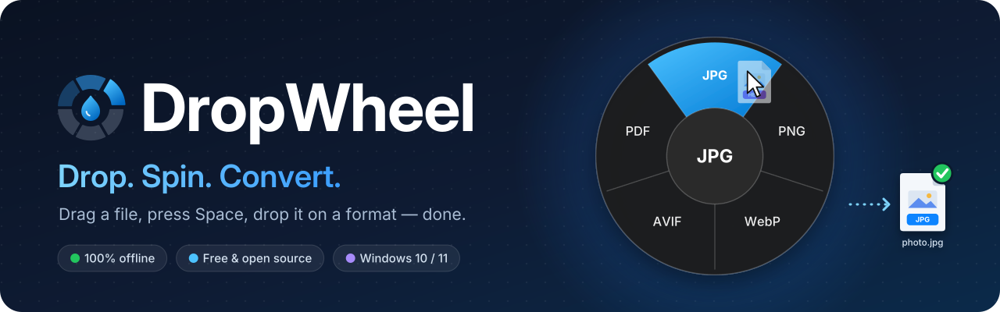
</p>

<p align="center">
  <a href="README.md">English</a> · <b>Русский</b>
</p>

<p align="center">
  <b>DropWheel</b> — офлайн-конвертер файлов для Windows: тащишь файл, жмёшь клавишу — под курсором колесо форматов,<br>
  бросаешь на нужный — рядом появляется готовый файл. Всё локально, без интернета.<br>
  Так же — с целой папкой и с картинкой, которую тащишь прямо из браузера.
</p>

<p align="center">
  <a href="https://github.com/Luchano55/dropwheel/actions/workflows/build.yml"></a>
  <a href="https://github.com/Luchano55/dropwheel/releases/latest"></a>
  <a href="https://github.com/Luchano55/dropwheel/releases/tag/dev-build"></a>
  <a href="#установка"></a>
  <a href="https://dotnet.microsoft.com/download/dotnet/8.0"></a>
  <a href="LICENSE"></a>
  <a href="#конфиденциальность"></a>
  <a href="#конфиденциальность"></a>
</p>

<p align="center">
  <a href="https://github.com/Luchano55/dropwheel/releases/latest"></a>
</p>

<p align="center">
  <a href="#как-это-работает">Как это работает</a> ·
  <a href="#возможности">Возможности</a> ·
  <a href="#скриншоты">Скриншоты</a> ·
  <a href="#поддерживаемые-форматы">Форматы</a> ·
  <a href="#установка">Установка</a> ·
  <a href="#как-пользоваться">Как пользоваться</a> ·
  <a href="#частые-вопросы">Вопросы</a> ·
  <a href="#планы">Планы</a>
</p>

<p align="center">
  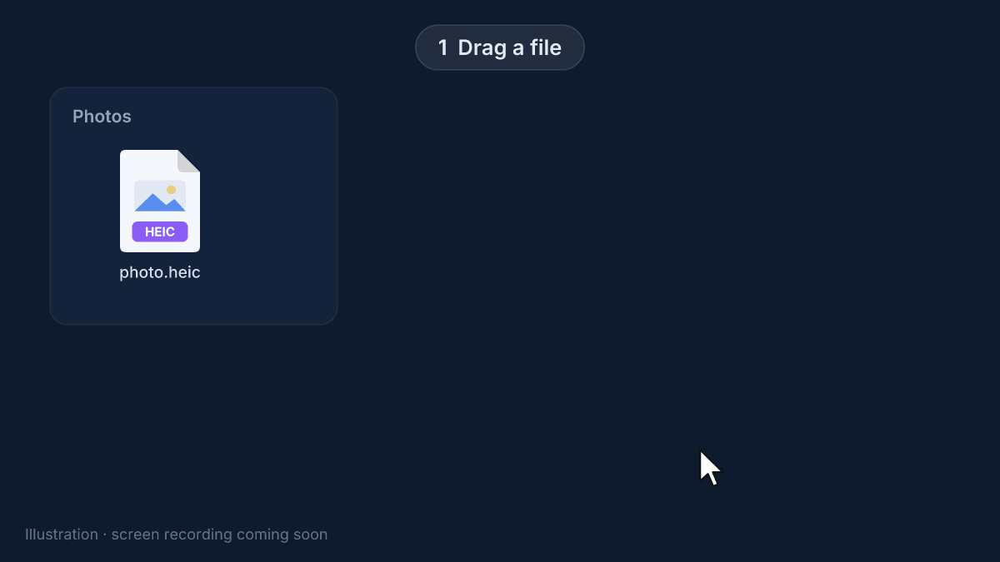<br>
  <sub>Настоящая запись в Windows (автоматическое демо): мышью управляет скрипт на машине GitHub Actions с Windows Server 2025.</sub>
</p>

## Как это работает

1. **Потащите** любой файл — из проводника, с рабочего стола, из окна папки. Кнопку мыши не отпускайте.
2. **Нажмите <kbd>Пробел</kbd>.** Под курсором появится колесо форматов. Ещё раз <kbd>Пробел</kbd> — переключение **Конвертация ↔ Инструменты**; <kbd>Esc</kbd> — закрыть.
3. **Бросьте** файл на лепесток. Всё: `photo.heic` превращается в `photo.jpg` в той же папке, а уведомление с превью сообщит, что готово.

Без перетаскивания: правый клик по файлу → **«Конвертировать…»** — откроется то же колесо, просто щёлкните по лепестку.

Те же три шага работают для **целой папки** (`Отпуск` → `Отпуск (JPG)`), для **картинки, которую тащите из Chrome, Edge или Firefox**, и для того, что лежит в буфере обмена: <kbd>Ctrl</kbd>+<kbd>Alt</kbd>+<kbd>V</kbd> — колесо для скопированного.

## Возможности

- 🎯 **Прямо под курсором** — не нужно открывать программу и искать «Сохранить как». Стеклянное колесо в теме Windows (светлой или тёмной) и цвете акцента.
- ✈️ **100% офлайн** — ffmpeg, ImageMagick, qpdf, poppler и 7-Zip лежат в архиве, файлы никуда не отправляются.
- 🛡️ **Исходник не трогается** — никогда не перезаписывается и не удаляется. Имя занято — будет `photo (1).jpg`.
- 📄 **Документы Office** — Word, Excel и PowerPoint через установленный Microsoft Office, заранее «прогретый» в фоне, поэтому быстро. Нет Office — DOCX → PDF, TXT, HTML, Markdown и XLSX → CSV всё равно работают.
- 🔎 **Текст с картинки** — распознавание (OCR), встроенное в Windows: скриншот или скан превращается в `.txt`. И PDF → текст.
- 🗜️ **Архивы** — упаковать в ZIP или 7Z; распаковать ZIP, 7Z, RAR, TAR, GZ, BZ2, XZ — сразу в папку с именем архива.
- 📚 **Много файлов сразу** — сконвертировать пачку, склеить PDF, собрать фото в один PDF, упаковать всё в один архив.
- 📁 **Папки целиком** — правый клик по папке → «Конвертировать…» или папку перетащить + <kbd>Пробел</kbd>. До 1000 файлов вместе с подпапками; результат — в папке рядом, `Отпуск (JPG)`, и одно уведомление на всю папку.
- 🌐 **Картинки из браузера** — тащите картинку с сайта в Chrome, Edge или Firefox и жмите <kbd>Пробел</kbd>, без «Сохранить картинку как…». И всё равно офлайн: программа берёт картинку, которую отдаёт браузер, и ничего не скачивает.
- 📋 **Из буфера обмена** — скопировали файлы или снимок экрана, нажали <kbd>Ctrl</kbd>+<kbd>Alt</kbd>+<kbd>V</kbd> — колесо у курсора.
- ✂️ **Обрезка видео** — «Инструменты» → «Обрезать…»: окно с кадром, полосой миниатюр и двумя ручками. По умолчанию мгновенно и без потери качества, при необходимости — точно по кадру.
- 🎬 **Видео: повернуть, кадры, обложка** — повернуть на 90°, нарезать кадры по секунде, сохранить кадр-обложку в JPG.
- ⚡ **Очередь в фоне** — до двух задач одновременно, окно задач у трея в стиле Windows 11, уведомление с превью и кнопками «Открыть» и «Показать в папке».
- 🖱️ **Меню проводника** — «Конвертировать…» открывает то же колесо, для одного файла или выделения, без прав администратора.
- 📦 **Установщик или архив, обновляется сама** — установщик без прав администратора или просто распаковать и запустить; .NET ставить не нужно. Новые версии — одним кликом в меню значка; только стабильные или все тестовые сборки — на ваш выбор.
- 🔤 **Любые имена** — кириллица, пробелы, длинные пути: `Мои фото\тест 1.heic` работает.
- 🌍 **Русский и английский** — интерфейс на языке Windows, переключается в настройках.
- 💸 **Бесплатно и с открытым кодом** — лицензия MIT, без рекламы и ограничений.

## Скриншоты

<table>
  <tr>
    <td align="center" width="50%">
      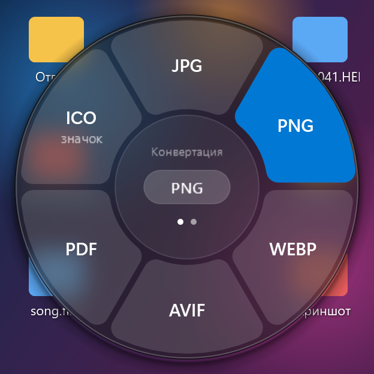<br>
      <sub><b>Фото → Конвертация</b> — лепесток под курсором заливается цветом акцента</sub>
    </td>
    <td align="center" width="50%">
      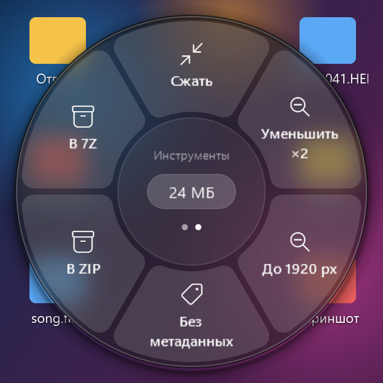<br>
      <sub><b>Фото → Инструменты</b> — ещё раз <kbd>Пробел</kbd></sub>
    </td>
  </tr>
  <tr>
    <td align="center" width="50%">
      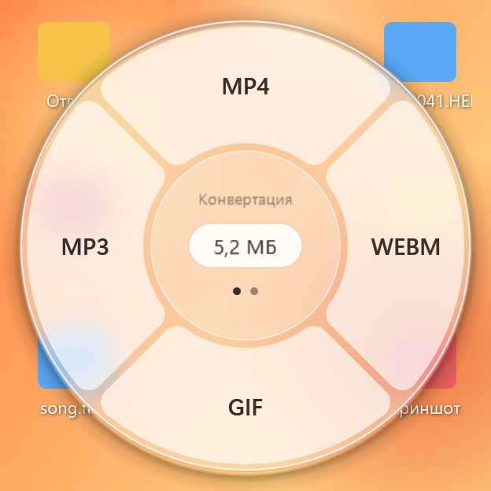<br>
      <sub><b>Видео</b> — MP4, WebM, GIF или только звук в MP3</sub>
    </td>
    <td align="center" width="50%">
      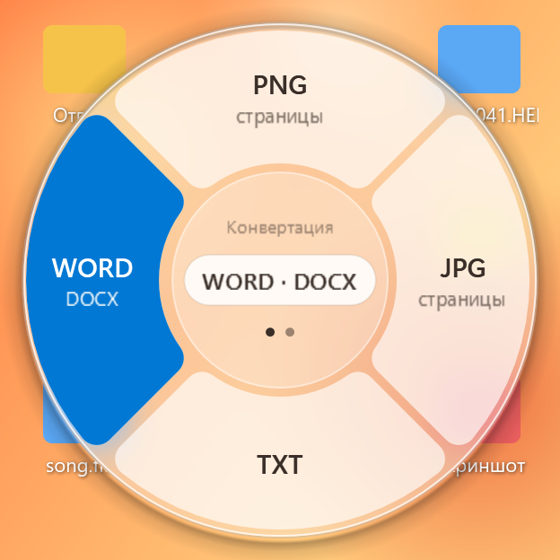<br>
      <sub><b>PDF</b> — страницы картинками, текст или редактируемый DOCX</sub>
    </td>
  </tr>
  <tr>
    <td align="center" width="50%">
      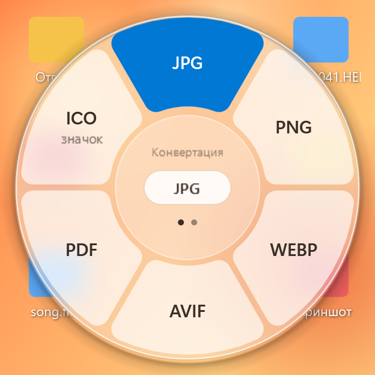<br>
      <sub><b>Папка целиком</b> — «Конвертировать…» по папке <code>Отпуск</code>: форматы для фото внутри, результат — в <code>Отпуск (JPG)</code></sub>
    </td>
    <td align="center" width="50%">
      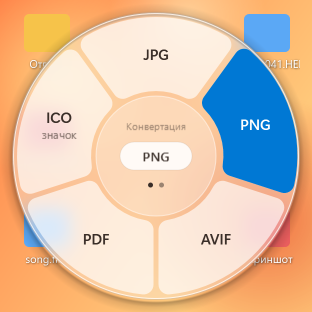<br>
      <sub><b>Картинка из браузера</b> — тащите WebP с сайта, <kbd>Пробел</kbd>, бросьте на PNG</sub>
    </td>
  </tr>
  <tr>
    <td align="center" width="50%">
      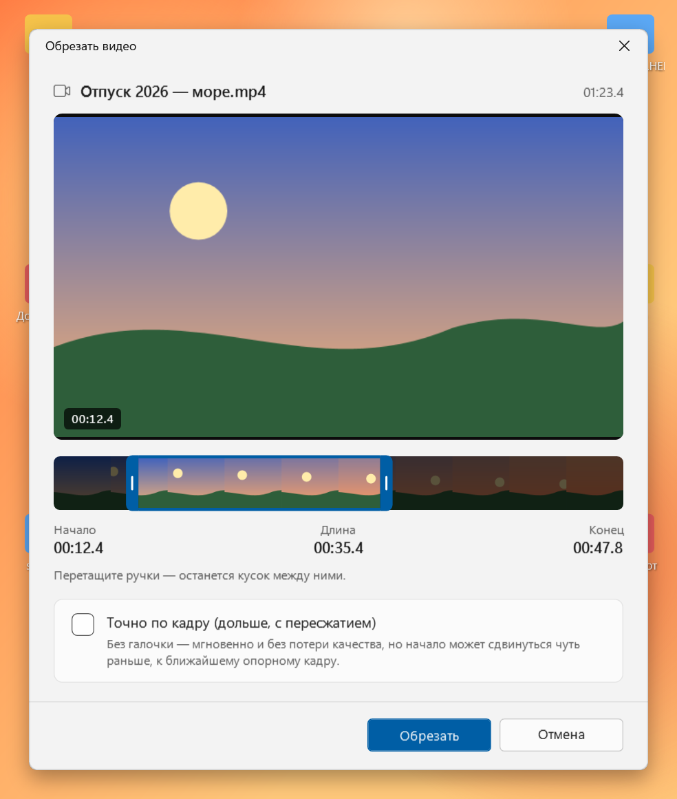<br>
      <sub><b>Обрезка видео</b> — двигайте ручки, останется кусок между ними</sub>
    </td>
    <td align="center" width="50%">
      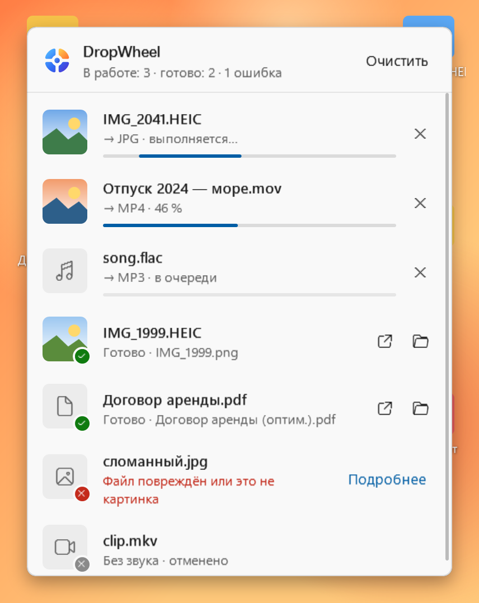<br>
      <sub><b>Окно задач</b> — щелчок по значку в трее: прогресс, «Отмена», «Открыть», «Показать в папке»</sub>
    </td>
  </tr>
  <tr>
    <td align="center" colspan="2">
      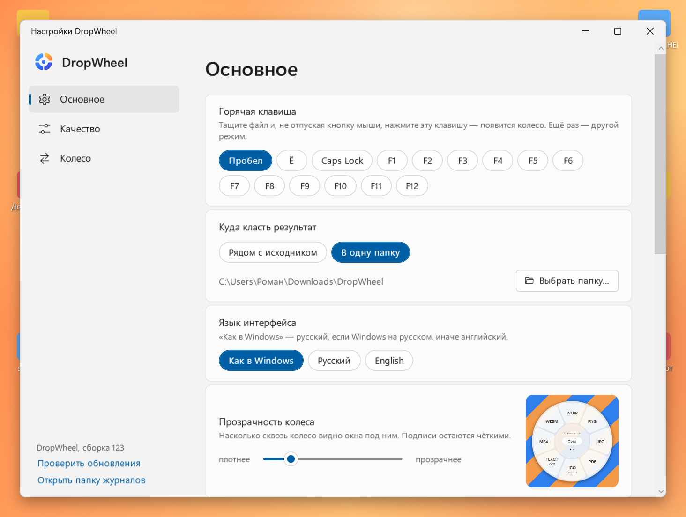<br>
      <sub><b>Настройки</b> — клавиша, папка для результатов, язык, прозрачность колеса с живым образцом; ниже — картинки из буфера и браузера, автозапуск, канал обновлений</sub>
    </td>
  </tr>
  <tr>
    <td align="center" colspan="2">
      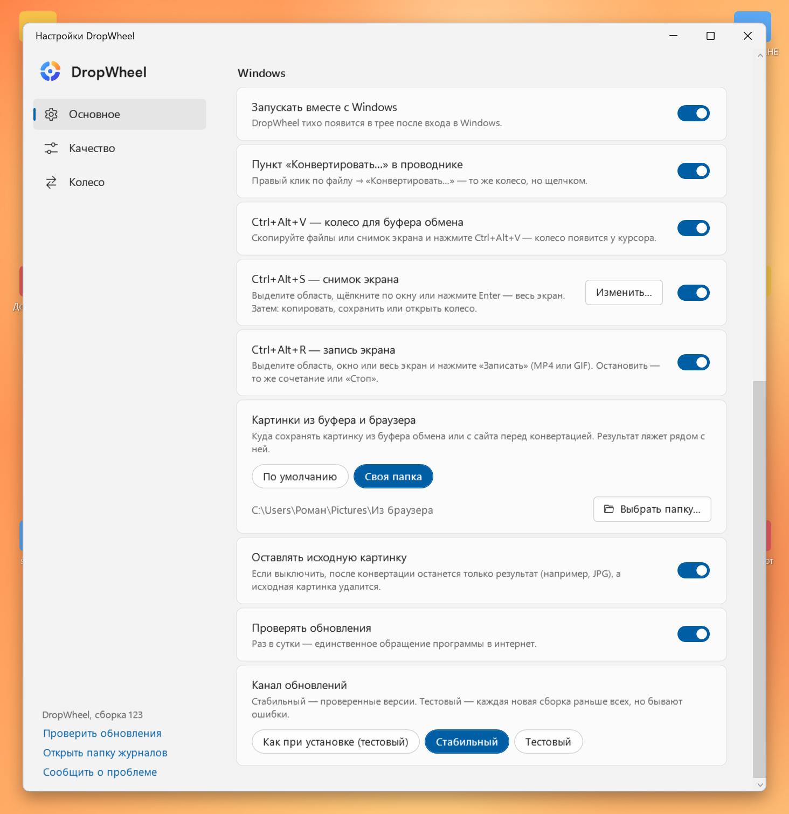<br>
      <sub><b>Настройки, ниже</b> — запуск вместе с Windows, пункт в проводнике, папка для картинок из буфера и браузера, «Оставлять исходную картинку», канал обновлений</sub>
    </td>
  </tr>
</table>

## Поддерживаемые форматы

Колесо предлагает только то, что подходит к файлу: для `.jpg` не будет «→ JPG», для видео — «→ PDF». Если файлов несколько и они разных типов — только общие варианты. Id операций (`to-jpg` и т. п.) нужны для [консольного режима](#как-пользоваться).

**Папке** колесо предлагает операции для того типа файлов, которых в ней больше всего (папка с фото → колесо для фото). Операция применяется ко всем подходящим файлам внутри, вместе с подпапками; результат — в новой папке рядом: `Отпуск` → `Отпуск (JPG)`, `Отпуск (сжато)`, с теми же подпапками. Файлы, которые уже в нужном формате, просто копируются; неподходящие пропускаются, их число — в уведомлении. «Один PDF» и «Склеить» дают один файл по имени папки (`Отпуск (все).pdf`). «В ZIP» и «В 7Z» для папок не предлагаются.

**Что нужно:** — = ничего, работает на любом ПК сразу после распаковки · **Office** = установлен Microsoft Office 2013 или новее · **Edge** = Edge WebView2 Runtime, он уже есть в Windows 10/11 · **OCR** = язык распознавания Windows (см. [ограничения](#известные-ограничения)). Операции с Office, Edge и OCR выполняет только приложение в трее, не `dropwheel-cli`.

<details open>
<summary><b>🖼️ Фото и картинки</b> — JPG, PNG, WebP, HEIC, AVIF, BMP, TIFF, GIF · на вход ещё SVG, PSD, RAW · на выход ещё ICO, текст (OCR), GIF → видео</summary>

<br>

**На вход:** JPG / JPEG / JFIF, PNG, WebP, HEIC / HEIF (фото с iPhone), AVIF, BMP, TIFF, GIF, а также только для чтения **SVG**, **PSD** (сведённое изображение) и **RAW** фотокамер: CR2, CR3 (Canon), NEF (Nikon), ARW (Sony), DNG, RAF (Fujifilm), ORF (Olympus), RW2 (Panasonic).

| | Операция | Что получится | Что нужно | Id |
|---|---|---|---|---|
| Конвертация | → JPG · PNG · WebP · AVIF | та же картинка в новом формате (поворот по EXIF применяется, прозрачность в JPG — на белом) | — | `to-jpg` `to-png` `to-webp` `to-avif` |
| Конвертация | → PDF | PDF на одну страницу | — | `to-pdf` |
| Конвертация | → ICO (значок) | значок Windows: картинка по центру прозрачного квадрата, размеры 256…16 px | — | `img-ico` |
| Конвертация | → Текст (OCR) | распознанный текст в `скан.txt` (из JPG, PNG, BMP, TIFF) | **OCR** | `img-ocr` |
| Конвертация | GIF → MP4 · WebM | анимированный GIF настоящим видео (H.264 / VP9, без звука) — намного меньше | — | `gif-to-mp4` `gif-to-webm` |
| Инструмент | Сжать | JPG/WebP с качеством 80 → `photo (сжато).jpg` | — | `img-compress` |
| Инструмент | Уменьшить ×2 | вдвое меньше по ширине и высоте → `photo (50%).jpg` | — | `img-half` |
| Инструмент | До 1920 px | длинная сторона ≤ 1920 px, маленькие не растягиваются → `photo (1920).jpg` | — | `img-1920` |
| Инструмент | Без метаданных | убирает EXIF, координаты GPS, данные камеры → `photo (без метаданных).jpg` | — | `img-strip` |
| Инструмент | Обрезать… | окно с рамкой (8 ручек) и пропорциями «Свободно» / 1:1 / 4:3 / 16:9 / «Как было» → `photo (обрезано).jpg`, тот же формат, прозрачность сохраняется. По одной картинке. CLI: `--crop 800x600+100+50` | — | `img-crop` |
| Инструмент | Один PDF (2+ картинки) | каждая картинка — страница → `photo (все).pdf` | — | `images-to-pdf` |

Инструменты сохраняют формат обычных картинок; HEIC, AVIF, SVG, PSD и RAW дают JPG.

</details>

<details>
<summary><b>🎬 Видео</b> — MP4, MOV, MKV, WebM, AVI · субтитры → SRT · поворот, кадры, обложка</summary>

<br>

**На вход:** MP4 / M4V, MOV, MKV, WebM, AVI

| | Операция | Что получится | Что нужно | Id |
|---|---|---|---|---|
| Конвертация | → MP4 | H.264 + AAC, играет везде, быстрый старт в браузере | — | `to-mp4` |
| Конвертация | → WebM | VP9 + Opus | — | `to-webm` |
| Конвертация | → GIF | 15 кадров/с, до 640 px по ширине, подобранная палитра | — | `to-gif` |
| Конвертация | → MP3 | только звуковая дорожка | — | `video-to-mp3` |
| Конвертация | → JPG (кадр) | обложка: кадр на 1-й секунде (у ролика короче — последний) → `clip (кадр).jpg` | — | `video-poster` |
| Инструмент | Сжать | H.264 с CRF 28 → `clip (сжато).mp4` | — | `video-compress` |
| Инструмент | 720p | короткая сторона ≤ 720 px, вертикальное видео остаётся вертикальным → `clip (720p).mp4` | — | `video-720p` |
| Инструмент | Без звука | убирает звук без перекодирования → `clip (без звука).mp4` | — | `video-mute` |
| Инструмент | Повернуть ↻ | на 90° по часовой, перекодирование в H.264 + AAC → `clip (повёрнуто).mp4` | — | `video-rotate-cw` |
| Инструмент | Обрезать… | окно с ручками «начало» / «конец» над полосой кадров → `clip (обрезано).mp4`, тот же формат, мгновенно и без потерь (начало — по опорному кадру); «Точно по кадру» — с перекодированием в H.264 + AAC. По одному видео. CLI: `--start 0:05 --end 0:12 [--exact]` | — | `video-trim` |
| Инструмент | Кадры | по JPG на каждую секунду (не больше 300) → папка `clip (кадры)` с `кадр-001.jpg`… | — | `video-frames` |
| Инструмент | Субтитры SRT | первая дорожка субтитров → `clip.srt` рядом с видео (плееры подхватывают сами); субтитры-картинки с DVD/Blu-ray не поддерживаются | — | `video-subs` |

</details>

<details>
<summary><b>🎵 Звук</b> — MP3, M4A, WAV, FLAC, OGG, Opus</summary>

<br>

**На вход:** MP3, M4A, WAV, FLAC, OGG, Opus

| | Операция | Что получится | Что нужно | Id |
|---|---|---|---|---|
| Конвертация | → MP3 · M4A · WAV · FLAC · OGG | MP3 — 192 кбит/с, остальные — с разумными настройками | — | `to-mp3` `to-m4a` `to-wav` `to-flac` `to-ogg` |
| Инструмент | Нормализовать | выравнивание громкости по EBU R128 (−16 LUFS), формат тот же → `song (норм).flac` | — | `audio-normalize` |

</details>

<details>
<summary><b>📕 PDF</b> — страницы → PNG/JPG, → TXT, → DOCX · склеить, разбить, оптимизировать, повернуть</summary>

<br>

| | Операция | Что получится | Что нужно | Id |
|---|---|---|---|---|
| Конвертация | → PNG / JPG (страницы) | каждая страница картинкой (150 dpi) в папке `документ (страницы)` | — | `pdf-to-png` `pdf-to-jpg` |
| Конвертация | → TXT (текст) | текст с сохранением колонок и отступов; у скана текстового слоя нет — будет понятное сообщение, а не пустой файл | — | `pdf-to-txt` |
| Конвертация | → DOCX | редактируемый документ Word — PDF перестраивает сам Word | **Office** (Word) | `pdf-to-docx` |
| Конвертация | → Markdown | Word перестраивает PDF, затем заголовки, списки, жирный и таблицы — в Markdown | **Office** (Word), для длинных PDF небыстро | `pdf-to-md` |
| Конвертация | → MD (быстро) | мгновенно: текст в порядке чтения в `.md`, без заголовков и таблиц | — | `pdf-to-md-fast` |
| Инструмент | Склеить (2+ PDF) | один PDF в том порядке, в каком пришли файлы → `документ (объединено).pdf` | — | `pdf-merge` |
| Инструмент | Разбить | по PDF на страницу в папке `документ (по страницам)` | — | `pdf-split` |
| Инструмент | Оптимизировать | без потери качества: потоки объектов + максимальное сжатие Flate → `документ (оптим.).pdf` | — | `pdf-optimize` |
| Инструмент | Повернуть ↻ | все страницы на 90° по часовой, без перекодирования → `документ (повёрнуто).pdf` | — | `pdf-rotate` |

</details>

<details>
<summary><b>📄 Документы Office</b> — Word, Excel, PowerPoint · с Microsoft Office и без него</summary>

<br>

**С Microsoft Office** (2013 или новее) конвертирует сам Office — точно как «Сохранить как». DropWheel запускает свой отдельный невидимый экземпляр и не трогает ваши открытые документы; файлы открываются только для чтения, макросы запрещены, на документ с паролем — сообщение «Документ защищён паролем», а не окно с вопросом. Office **прогревается заранее**: как только колесо показало формат Office, Word, Excel или PowerPoint запускается в фоне, пока вы целитесь, — поэтому бросок срабатывает быстро (первый запуск «с холода» — около 3–5 с, дальше — около 1 с на документ). Через 5 минут простоя он закрывается. Word, Excel и PowerPoint проверяются по отдельности — в колесе только то, что у вас установлено.

**Без Office** самое нужное делают встроенные библиотеки и Edge.

| На вход | С Microsoft Office | Без Office | Id |
|---|---|---|---|
| **Word:** DOC, DOCX, DOCM, RTF, ODT | → PDF · DOCX · DOC · ODT · RTF · TXT | только DOCX / DOCM: → **PDF** через Edge, «почти как в Word» (**Edge**) · → **TXT** | `word-to-pdf` `word-to-docx` `word-to-doc` `word-to-odt` `word-to-rtf` `word-to-txt` |
| **Word:** DOCX, DOCM | → HTML (самодостаточная страница, картинки внутри) · Markdown — в любом случае встроенными библиотеками | так же | `word-to-html` `word-to-md` |
| **Excel:** XLS, XLSX, XLSM, ODS, CSV | → PDF (вся книга) · XLSX · XLS · CSV (первый лист, UTF-8) · ODS | XLSX / XLSM / XLS → **CSV** (первый лист, значения как в ячейках Excel, UTF-8 — русский Excel открывает без «кракозябр» и сразу по столбцам) | `excel-to-pdf` `excel-to-xlsx` `excel-to-xls` `excel-to-csv` `excel-to-ods` |
| **CSV** | → XLSX: разделитель (`;` `,` Tab) и кодировка (UTF-8 / Windows-1251) угадываются, числа и даты становятся настоящими ячейками, коды вроде `007` остаются текстом, формулы не создаются никогда — в любом случае встроенными библиотеками | так же | `csv-to-xlsx` |
| **PowerPoint:** PPT, PPTX, PPTM, ODP | → PDF · PPTX · PPT · ODP · Слайды PNG (папка `доклад (слайды)`, 1920 px по ширине) | — | `ppt-to-pdf` `ppt-to-pptx` `ppt-to-ppt` `ppt-to-odp` `ppt-to-png` |
| **PDF** | → DOCX · Markdown (см. PDF выше) | «MD (быстро)» — просто текст | `pdf-to-docx` `pdf-to-md-fast` |

</details>

<details>
<summary><b>📝 Текст, Markdown, HTML</b> — → PDF, Markdown → HTML, починить кодировку → UTF-8</summary>

<br>

| | На вход | Что получится | Что нужно | Id |
|---|---|---|---|---|
| Конвертация | TXT · Markdown · HTML | → **PDF** (A4) печатью через Edge, без адреса и даты браузера; у Markdown — таблицы, код и картинки | **Edge** | `text-to-pdf` |
| Конвертация | Markdown (`.md`, `.markdown`) | → **HTML**: оформленная страница с таблицами, списками задач, сносками | — | `md-to-html` |
| Инструмент | TXT · CSV · SRT · MD · INI · LOG · XML · JSON | **В UTF-8** — лечит «кракозябры»: Windows-1251, DOS-866 или UTF-16 → UTF-8 → `заметки (UTF-8).txt` (файл, уже записанный в UTF-8, не трогается) | — | `text-to-utf8` |

</details>

<details>
<summary><b>🗜️ Архивы</b> — ZIP встроенный · 7Z, RAR, TAR, GZ, BZ2, XZ через 7-Zip · упаковать в ZIP / 7Z</summary>

<br>

| | Операция | Что получится | Что нужно | Id |
|---|---|---|---|---|
| Инструмент | В ZIP (любые файлы) | один файл → `photo.zip`; несколько — один архив по имени их папки | — (встроено) | `zip-pack` |
| Инструмент | В 7Z (любые файлы) | то же, но архив 7Z | — (7-Zip в комплекте) | `pack-7z` |
| Инструмент | Распаковать ZIP | в папку с именем архива; кириллица из старых архиваторов Windows читается правильно; архив с путями за пределы папки (Zip Slip) отклоняется | — (встроено) | `zip-extract` |
| Инструмент | Распаковать 7Z · RAR · TAR · GZ · TGZ · BZ2 · XZ | в папку с именем архива; `.tar.gz` — сразу файлы | — (7-Zip в комплекте) | `archive-extract` |

Архивы с паролем не поддерживаются — будет понятное сообщение.

</details>

Исходный файл никогда не меняется и не удаляется. Если имя занято — `photo (1).jpg`. Инструменты добавляют пометку: `photo (сжато).jpg`.

## Установка

### Установщик (рекомендуется)

1. Скачайте **`DropWheel-Setup-<версия>.exe`** из [последнего релиза](https://github.com/Luchano55/dropwheel/releases/latest).
2. Запустите его. Права администратора не нужны: DropWheel ставится только для вас, в `%LocalAppData%\Programs\DropWheel`, и появляется в меню «Пуск». По желанию — ярлык на рабочем столе и «Запускать вместе с Windows».
3. DropWheel запустится сразу — в трее (у часов, может быть под стрелкой «^») появится значок-кольцо. Тащите файл и жмите <kbd>Пробел</kbd>.

**Удаление:** «Параметры → Приложения → DropWheel → Удалить» (или «Установка и удаление программ»). Программа закроется, пункт в меню проводника и автозапуск уберутся. Настройки в `%AppData%\DropWheel` остаются — удалите папку сами, если они не нужны.

### Архив без установки

1. Скачайте **`DropWheel-win-x64.zip`** из того же [релиза](https://github.com/Luchano55/dropwheel/releases/latest). Полный архив (программа + утилиты) нужен только для первой установки.
2. Распакуйте его в папку, **куда у вас есть право записи**, например `C:\DropWheel` или папку в своём профиле, — **не** в `C:\Program Files`: самообновление заменяет файлы в этой папке. Внутри: `DropWheel.exe` (программа), `dropwheel-cli.exe`, папка `tools` (ffmpeg, ImageMagick, qpdf, poppler, 7-Zip) и `try-dropwheel.cmd`. Папка `tools` должна лежать рядом с `DropWheel.exe`.
3. Запустите **`DropWheel.exe`**. Окна нет — в трее (у часов, может быть под стрелкой «^») появится значок-кольцо. Теперь можно тащить файл и жать <kbd>Пробел</kbd>.

Удалить архивную версию: правый клик по значку → снять галочку «Пункт „Конвертировать…“ в проводнике» (пункт меню исчезнет) → «Выход». Потом удалите папку программы и, если хотите, `%AppData%\DropWheel` (настройки и журналы).

### winget (скоро)

```
winget install Luchano55.DropWheel
```

Пакет `Luchano55.DropWheel` отправлен в каталог Windows Package Manager и ждёт проверки — команда заработает, когда его примут. Пока — ставьте установщиком.

### Стабильные версии и тестовые сборки

- **Стабильные** — релизы с тегом `vX.Y.Z` ([последний](https://github.com/Luchano55/dropwheel/releases/latest)), что нового — в [`docs/CHANGELOG.md`](docs/CHANGELOG.md).
- **Тестовые** — каждая сборка из `main`, предрелиз [`dev-build`](https://github.com/Luchano55/dropwheel/releases/tag/dev-build) (там тоже есть установщик и архивы). Свежее, но проверено меньше.

Программа обновляется из того канала, откуда её взяли; сменить — «Настройки → Основное → Канал обновлений».

**SmartScreen.** Если Windows покажет «Windows защитила ваш компьютер» — нажмите «Подробнее» → «Выполнить в любом случае» (программа не подписана, это нормально для личного проекта). Каждую сборку делает [GitHub Actions](https://github.com/Luchano55/dropwheel/actions/workflows/build.yml) прямо из кода этого репозитория.

**Дальше программа обновляется сама** (и установленная, и из архива): когда выходит новая сборка, в меню значка появляется пункт **«Обновить до сборки N»** — один клик, и DropWheel скачает только часть с программой (~100 МБ; утилиты — только если они поменялись), проверит по SHA-256, дождётся окончания текущих задач и перезапустится.

**Требования:** Windows 10 (1809 и новее) или Windows 11, 64-бит. Больше ничего ставить не нужно. По желанию: Microsoft Office 2013+ — для конвертаций Office; язык распознавания Windows — для OCR.

## Как пользоваться

### 🎡 Колесо: перетаскивание + <kbd>Пробел</kbd>

| Что делаете | Что происходит |
|---|---|
| Тащите файл и жмёте <kbd>Пробел</kbd> | под курсором появляется колесо; в «пилюле» в центре — размер файла |
| Ещё раз <kbd>Пробел</kbd> | режим **Конвертация** ↔ **Инструменты** |
| Наводите на лепесток | он подсвечивается, в центре — его название |
| Бросаете на лепесток | конвертация; готовый файл появится рядом с исходным |
| Бросаете в центр («Отмена»), жмёте <kbd>Esc</kbd> или отпускаете мимо | ничего не происходит |

<kbd>Пробел</kbd> перехватывается только во время перетаскивания — в остальное время он, как обычно, печатает пробелы и ставит видео на паузу.

### 🖱️ Проводник: «Конвертировать…»

Правый клик по одному или нескольким файлам → **«Конвертировать…»** → у курсора откроется то же колесо, в режиме клика:

| Что делаете | Что происходит |
|---|---|
| Щелчок по лепестку | конвертация |
| <kbd>Tab</kbd> или правая кнопка мыши | режим **Конвертация** ↔ **Инструменты** |
| Стрелки или колёсико мыши, затем <kbd>Enter</kbd> | выбор лепестка с клавиатуры |
| <kbd>Esc</kbd> или щелчок мимо | колесо закрывается |

На Windows 11 пункт — в «Показать дополнительные параметры» (или <kbd>Shift</kbd>+<kbd>F10</kbd>). Если DropWheel не запущен, он запустится сам.

### 📁 Папки целиком

Правый клик по папке → **«Конвертировать…»** (или перетащите папку и нажмите <kbd>Пробел</kbd>). Колесо покажет операции для того, чего в папке больше всего, — фото, видео, PDF…

| Что делаете | Что происходит |
|---|---|
| Выбираете **JPG** для папки `Отпуск` | рядом появляется `Отпуск (JPG)` с теми же подпапками: `Отпуск\2023\a.heic` → `Отпуск (JPG)\2023\a.jpg` |
| Выбираете инструмент, например **«Сжать»** | `Отпуск (сжато)`; файлы внутри — без пометки в имени, она уже в имени папки |
| Выбираете **«Один PDF»** или **«Склеить»** | один файл по имени папки: `Отпуск (все).pdf`, `Документы (объединено).pdf` |

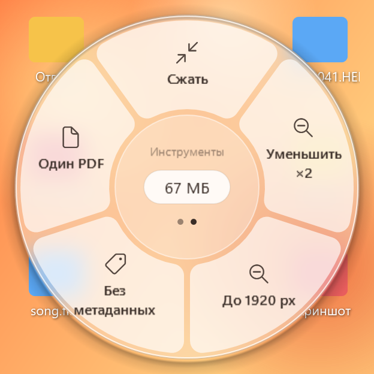

Файлы, которые уже в нужном формате, копируются — в `Отпуск (JPG)` окажутся все фото, а не только бывшие HEIC. Файлы, к которым операция не подходит, пропускаются; скрытые и системные (`desktop.ini`, `Thumbs.db`) не трогаются. Уведомление — **одно** на всю папку: сколько готово, пропущено, не получилось — и кнопка «Открыть» для папки с результатом. За раз — до 1000 файлов; если больше, программа попросит выбрать папку поменьше. Если в настройках выбрано «В одну папку», `Отпуск (JPG)` появится там.

<br clear="right">

### 🌐 Картинки из браузера

Тащите картинку с сайта в **Chrome, Edge или Firefox**, нажмите <kbd>Пробел</kbd> и бросьте на формат — как обычный файл. Картинка сначала сохраняется в ту же папку, что и картинки из буфера обмена (по умолчанию «Изображения\DropWheel»), с именем с сайта, а результат появляется рядом с ней.

- Формат определяется по самой картинке: сайты часто отдают WebP под именем `.jpg` — DropWheel это видит и сохраняет файл как `.webp`.
- **Ничего не скачивается.** Программа берёт данные картинки, которые браузер отдаёт при перетаскивании. Если браузер дал только ссылку (фоновая картинка, ссылка на картинку), колесо так и скажет — сохраните картинку и перетащите файл.
- Если тащить текст или ссылку на страницу, колесо не появляется.

### ✂️ Обрезка видео

Тащите видео → **«Инструменты»** → **«Обрезать…»** (лепесток есть и в колесе из меню проводника и из буфера). Откроется окно:

- кадр в месте ручки, полоса миниатюр и две ручки — **«начало»** и **«конец»**; под ними — время начала, длина и конец;
- <kbd>←</kbd>/<kbd>→</kbd> двигают ручку на 0,1 с, с <kbd>Shift</kbd> — на 1 с; <kbd>Home</kbd>/<kbd>End</kbd>; <kbd>Tab</kbd> — другая ручка; <kbd>Enter</kbd> — обрезать, <kbd>Esc</kbd> — отмена.

По умолчанию обрезка **мгновенная и без потери качества** — `clip (обрезано).mp4`, формат тот же; начало встаёт на ближайший опорный кадр, поэтому ролик может начаться на долю секунды раньше. Галочка **«Точно по кадру»** — ровно с выбранного кадра, но с пересжатием в H.264 + AAC (`.mp4`), и это дольше. По одному видео за раз.

### 📋 Из буфера обмена: <kbd>Ctrl</kbd>+<kbd>Alt</kbd>+<kbd>V</kbd>

Скопируйте файлы в проводнике (<kbd>Ctrl</kbd>+<kbd>C</kbd>) или сделайте снимок экрана (<kbd>Win</kbd>+<kbd>Shift</kbd>+<kbd>S</kbd>, «Копировать изображение» в браузере) и нажмите <kbd>Ctrl</kbd>+<kbd>Alt</kbd>+<kbd>V</kbd> — или правый клик по значку → **«Из буфера обмена…»**. У курсора откроется колесо: для скопированных файлов — как в «Конвертировать…»; картинка сначала сохраняется в `Буфер 2026-10-22 10-31-05.png` в папке «Изображения\DropWheel» (или в общей папке для результатов, если она выбрана), дальше — JPG, WebP, PDF, ICO, текст (OCR)… В буфере только текст — короткая подсказка. В «Настройки → Основное → Картинки из буфера и браузера» можно выбрать для таких картинок свою папку и выключить **«Оставлять исходную картинку»** — тогда после удачной конвертации останется только результат (например, JPG), а промежуточный PNG удалится. Сочетание выключается в настройках; если его уже заняла другая программа, DropWheel работает без него (пункт в трее остаётся). Скопированные папки из буфера не берутся — для папки есть «Конвертировать…».

### 🔔 Значок в трее, задачи и уведомления

- **Левый клик** по значку — окно задач: миниатюры, прогресс, кнопка «Отмена»; у готовых — «Открыть» и «Показать в папке», у ошибок — причина и «Подробнее».
- **Двойной клик** — окно настроек.
- **Правый клик** — «Задачи», «Из буфера обмена…», «Настройки…», включение/выключение пункта в проводнике, «Открыть журнал», «Проверить обновления», «Выход».
- Пока идёт работа, на значке — оранжевый кружок с числом задач.
- **Уведомления** — с превью результата и кнопками «Открыть» и «Показать в папке». Несколько файлов готовы почти одновременно — одно уведомление «Готово: N файлов»; целая папка — одно уведомление на папку.

### 🔄 Обновления

Раз в сутки (и по кнопке «Проверить обновления») DropWheel читает маленький файл `version.json` из [последнего стабильного релиза](https://github.com/Luchano55/dropwheel/releases/latest) или, на тестовом канале, из [релиза `dev-build`](https://github.com/Luchano55/dropwheel/releases/tag/dev-build) («Настройки → Основное → Канал обновлений»). Если есть сборка новее, в меню значка появляется **«Обновить до сборки N»** — пока вы не нажмёте, ничего не скачивается. Не нужна даже проверка — выключите «Проверять обновления» в окне настроек. Это единственное, что программа делает в сети.

### ⚙️ Настройки

Двойной клик по значку в трее (или правый клик → «Настройки…»). Всё применяется сразу, без кнопки «ОК», и сохраняется в `%AppData%\DropWheel\settings.json`.

- **Горячая клавиша** — <kbd>Пробел</kbd> (по умолчанию), <kbd>Ё</kbd>, <kbd>Caps Lock</kbd>, <kbd>F1</kbd>–<kbd>F12</kbd> или любая своя («Своя…»: Tab, Num 5, F13… — кроме Ctrl/Shift/Alt/Win/Esc/Enter); работает сразу, без перезапуска.
- **Язык интерфейса** — «Как в Windows» (по умолчанию: русский для русской Windows, иначе английский), «Русский» или «English»; меняется сразу.
- **Прозрачность колеса** — ползунок «плотнее ↔ прозрачнее» с живым образцом; подписи и выбранный лепесток остаются чёткими.
- **Куда класть результат** — рядом с исходником или всё в одну папку (по умолчанию «Загрузки\DropWheel»).
- **Качество** — JPG и WebP (50–100), видео CRF (18–32, меньше — лучше), битрейт MP3 (128–320 кбит/с). Действует на новые задачи.
- **Картинки из буфера и браузера** — папка по умолчанию или своя; **«Оставлять исходную картинку»** — включить или выключить.
- **Запуск вместе с Windows**, пункт в проводнике, <kbd>Ctrl</kbd>+<kbd>Alt</kbd>+<kbd>V</kbd> для буфера обмена, ежедневная проверка обновлений и **канал обновлений** (стабильный или тестовый).
- **Своё колесо** — для каждого типа файлов (фото, видео, звук, PDF, Word, Excel, PowerPoint, текст, архивы, любые файлы): порядок форматов (перетаскиванием или ↑/↓), скрыть ненужные, рядом — живой образец колеса. **«Последний выбор — первым»** ставит наверх формат, выбранный в прошлый раз для этого типа.

### ⌨️ Консольный режим

Консольный режим умеет всё, кроме операций с Office, Edge и OCR.

**Самый простой способ:** перетащите любой файл (фото, видео, музыку, PDF) мышкой на `try-dropwheel.cmd`. Откроется чёрное окно со списком подходящих операций — введите нужную (например `to-jpg`) и нажмите Enter. Готовый файл появится рядом с исходным.

Из командной строки:

```bat
dropwheel-cli.exe list "C:\Мои фото\тест 1.heic"
dropwheel-cli.exe convert "C:\Мои фото\тест 1.heic" to-jpg
dropwheel-cli.exe convert "1.pdf" "2.pdf" pdf-merge --out-dir "C:\Готово"
dropwheel-cli.exe convert "C:\Фото\Отпуск" to-jpg
dropwheel-cli.exe convert "ролик.mp4" video-trim --start 0:05 --end 0:12 --exact
```

`list` без файла — все операции; вместо файла можно указать папку; у `video-trim` — `--start` и `--end` (без них — с начала / до конца) и `--exact` — точно по кадру; `--out-dir` — куда класть результат (по умолчанию — рядом с исходником); `-v` — показывать команды утилит; `--lang ru` или `--lang en` — язык сообщений (по умолчанию — как в системе).

## Конфиденциальность

- **100% офлайн.** Вся конвертация — на вашем компьютере. Файлы никуда не загружаются: отправлять их просто некуда.
- **Никакой телеметрии, аналитики, учётных записей и рекламы.**
- **Единственное, что программа делает в сети, — проверка обновлений:** раз в сутки (и по кнопке «Проверить обновления») она читает маленький файл `version.json` из [релизов](https://github.com/Luchano55/dropwheel/releases/tag/dev-build) этого репозитория. Ни файлы, ни личные данные не отправляются; обновление ставится, только когда вы нажмёте «Обновить», и проверяется по SHA-256. Отключить совсем: `"checkForUpdates": false` в `%AppData%\DropWheel\settings.json`.
- **Картинки из браузера** программа берёт из того, что браузер отдаёт при перетаскивании, — по ссылкам она не ходит.
- Microsoft Office, Edge WebView2 и распознавание Windows тоже работают локально.
- Настройки и журналы лежат у вас: `%AppData%\DropWheel`. В журнале есть пути к файлам и тексты ошибок — гляньте его, прежде чем прикладывать к сообщению об ошибке.

## Известные ограничения

- **Окна, запущенные от администратора.** Windows не даёт обычным программам работать с такими окнами (UIPI): если тащить файл из программы, запущенной от администратора, колесо не появится. Тащите из обычного окна.
- **DOCX → PDF / HTML без Office — «почти как в Word».** Шрифты, списки, таблицы, картинки, размер листа и поля сохраняются, но строки и страницы разбивает браузер, а не Word, — страницы могут разойтись на строку-другую. Не переносятся колонтитулы и номера страниц, сноски, примечания, надписи, фигуры, SmartArt, диаграммы, старые картинки EMF/WMF, колонки. DOC, RTF, ODT, ODS и PowerPoint без Office не конвертируются. Нужно точно — нужен Office.
- **Для OCR нужен язык распознавания Windows.** Он ставится вместе с языком интерфейса Windows, или его можно добавить: «Параметры → Время и язык → Язык и регион». Если ни одного нет, лепестка «Текст (OCR)» просто не будет. OCR читает JPG, PNG, BMP и TIFF — другие форматы сначала переведите в PNG.
- **В сканированном PDF нет текста**, поэтому PDF → TXT сообщит об этом: сохраните страницы в PNG и распознайте их.
- **Архивы и документы с паролем** не поддерживаются.
- **Из браузера — только картинки.** Перетаскивание картинки работает в Chrome, Edge и Firefox; другое со страницы (видео, PDF) не берётся — сначала скачайте. Если браузер отдал только ссылку на картинку, будет подсказка, а не скачивание.
- **Папки — до 1000 файлов за раз**, «В ZIP» и «В 7Z» для папок не предлагаются (папку целиком с подпапками упакует сама Windows: «Отправить → Сжатая ZIP-папка»). Скопированные папки <kbd>Ctrl</kbd>+<kbd>Alt</kbd>+<kbd>V</kbd> не берёт.
- **Обрезка** — по одному видео; мгновенный режим начинает с ближайшего опорного кадра (точное начало — галочка «Точно по кадру»). В окне обрезки — кадры, а не проигрыватель.

## Частые вопросы

<details>
<summary><b>Это правда бесплатно?</b></summary>

Да. Открытый код под лицензией MIT: без рекламы, пробного периода, «про-версии» и ограничений.
</details>

<details>
<summary><b>Программа может испортить или удалить исходный файл?</b></summary>

Нет. Результат сначала пишется во временный файл и только потом переименовывается — если конвертация сорвалась, недоделанного файла не останется. Занятое имя → `photo (1).jpg`, `photo (2).jpg`…
</details>

<details>
<summary><b>Куда кладётся результат? Что за пометки вроде «(сжато)»?</b></summary>

Рядом с исходным: `photo.heic` → `photo.jpg`. Инструменты сохраняют формат, поэтому добавляют к имени пометку: `photo (сжато).jpg`, `clip (720p).mp4`, `clip (обрезано).mp4`, `song (норм).flac`, `clip (без звука).mp4`, `документ (повёрнуто).pdf`, `заметки (UTF-8).txt`. В английском интерфейсе пометки английские: `photo (compressed).jpg`. Целая папка — в папку рядом, например `Отпуск (JPG)`. Хотите всё в одно место — «Настройки → Основное → Куда класть результат → В одну папку».
</details>

<details>
<summary><b>Нужен ли Microsoft Office?</b></summary>

Нет. Без Office работают DOCX → PDF / TXT / HTML / Markdown, XLSX / XLS → CSV, CSV → XLSX и TXT / Markdown / HTML → PDF. С Office добавляются точные конвертации Word, Excel и PowerPoint (DOC, RTF, ODT, ODS, PPT, PPTX, ODP, слайды в PNG) и PDF → DOCX. DropWheel запускает свой скрытый экземпляр Office и не трогает ваши открытые документы; прогретый Word или Excel занимает примерно 100–200 МБ памяти, пока не закроется — через 5 минут простоя или при выходе из DropWheel.
</details>

<details>
<summary><b>Колесо не появляется по Пробелу.</b></summary>

- Проверьте, что DropWheel запущен (значок-кольцо в трее).
- Жмите <kbd>Пробел</kbd> <i>во время</i> перетаскивания, не отпуская кнопку мыши.
- Из окон, запущенных от администратора, колесо не сработает (см. <a href="#известные-ограничения">ограничения</a>).
- Из браузера колесо появляется только для картинок — не для текста, ссылок на страницы и других загрузок.
</details>

<details>
<summary><b>Пробел мешает. Можно другую клавишу?</b></summary>

Да. Двойной клик по значку в трее → «Основное» → «Горячая клавиша»: <kbd>Ё</kbd>, <kbd>Caps Lock</kbd>, <kbd>F1</kbd>–<kbd>F12</kbd> или «Своя…» — и нажмите любую клавишу. Работает сразу, перезапуск не нужен.
</details>

<details>
<summary><b>Можно сконвертировать целую папку?</b></summary>

Да: правый клик по папке → «Конвертировать…» или перетащите её и нажмите <kbd>Пробел</kbd>. Результат — в новой папке рядом (`Отпуск` → `Отпуск (JPG)`) с теми же подпапками; сама папка не меняется. До 1000 файлов за раз. Подробнее — [Папки целиком](#-папки-целиком).
</details>

<details>
<summary><b>Программа скачивает картинки из интернета?</b></summary>

Нет. Когда вы тащите картинку из браузера, браузер сам отдаёт её данные, и DropWheel сохраняет именно их. Если пришла только ссылка — будет подсказка, по ссылке программа не пойдёт. В сеть DropWheel обращается только для проверки обновлений.
</details>

<details>
<summary><b>Есть английский интерфейс?</b></summary>

Да. Интерфейс на русском и английском и по умолчанию следует языку Windows. Переключить: двойной клик по значку → «Основное» → «Язык интерфейса» («Как в Windows» / «Русский» / «English») — меню, колесо и окна меняются сразу.
</details>

<details>
<summary><b>Запускается ли вместе с Windows?</b></summary>

Если хотите — да: установщик предлагает «Запускать вместе с Windows», а переключить можно в любой момент: «Настройки → Основное → Запускать вместе с Windows».
</details>

<details>
<summary><b>Как обновиться и какая у меня сборка?</b></summary>

Раз в сутки программа сама проверяет, нет ли новой сборки, и предлагает «Обновить до сборки N» в меню значка. Правый клик по значку → «Проверить обновления» — проверить прямо сейчас (заодно покажет номер вашей сборки); версия и номер сборки есть и внизу окна настроек. Можно и вручную: запустить новый установщик поверх установленной версии или скачать полный архив из <a href="https://github.com/Luchano55/dropwheel/releases">Releases</a> и распаковать поверх старой папки. Только стабильные версии или все тестовые сборки — «Настройки → Основное → Канал обновлений».
</details>

<details>
<summary><b>Почему архив такой большой?</b></summary>

В нём ffmpeg, ImageMagick, qpdf, poppler и 7-Zip — чтобы всё работало офлайн сразу после распаковки, без докачки и настройки. Основной вес — это они. Обновления меньше: скачивается только часть с программой, утилиты — только когда они поменялись.
</details>

<details>
<summary><b>Что-то сломалось. Как сообщить?</b></summary>

Правый клик по значку → «Открыть журнал», возьмите самый свежий файл `.log` и приложите к <a href="https://github.com/Luchano55/dropwheel/issues/new/choose">сообщению об ошибке</a> вместе с версией Windows и номером сборки DropWheel.
</details>

## Планы

**Сделано в 1.0:**

- [x] Ядро конвертации: фото, видео, звук — ffmpeg + ImageMagick, очередь в фоне, безопасные имена файлов
- [x] Значок в трее, окно задач, уведомления с превью
- [x] Колесо: перетаскивание + <kbd>Пробел</kbd>, режимы «Конвертация» и «Инструменты», несколько мониторов и масштаб экрана, светлая/тёмная тема и цвет акцента, настраиваемая прозрачность
- [x] «Конвертировать…» в проводнике открывает то же колесо в режиме клика
- [x] PDF: склеить, разбить, повернуть, оптимизировать без потерь, страницы в картинки, → TXT
- [x] Документы через установленный Microsoft Office с прогревом в фоне
- [x] Документы без Office: DOCX → PDF / TXT / HTML / Markdown, XLSX / XLS → CSV, CSV → XLSX, TXT / Markdown / HTML → PDF
- [x] Распознавание текста (OCR) средствами Windows
- [x] Архивы: ZIP встроенный; 7Z, RAR, TAR, GZ, BZ2, XZ через 7-Zip; упаковать в ZIP / 7Z
- [x] Значки (ICO), SVG / PSD / RAW на вход, GIF → MP4 / WebM, субтитры → SRT, текст → UTF-8
- [x] Папки целиком: меню проводника или перетаскивание + <kbd>Пробел</kbd>, подпапки повторяются, одно уведомление на папку
- [x] Картинки из Chrome, Edge и Firefox перетаскиванием — офлайн, без скачивания
- [x] Видео: обрезка (без потерь или точно по кадру), кадры, обложка, поворот
- [x] Колесо для буфера обмена (<kbd>Ctrl</kbd>+<kbd>Alt</kbd>+<kbd>V</kbd>): скопированные файлы и снимки экрана
- [x] Окно настроек: клавиша, папка для результатов, качество, язык, прозрачность, автозапуск, картинки из буфера, канал обновлений; своё колесо (порядок, скрытые форматы, последний выбор — первым)
- [x] Интерфейс на русском и английском (как язык Windows; переключается в настройках)
- [x] Установщик без прав администратора, номера версий, стабильный и тестовый каналы обновлений; самообновление с проверкой SHA-256
- [x] Автоматическое демо и сквозной тест на настоящей Windows в CI
- [ ] Пакет winget `Luchano55.DropWheel` — отправлен, ждёт проверки

**Дальше:**

- [x] Картинки: обрезка с пропорциями («Свободно», 1:1, 4:3, 16:9, «Как было»)
- [ ] Встроенные редакторы: удаление фона, «добавить фон» (палитра, отступы, скругление, тень), пометки на картинке
- [ ] Архив поменьше: своя сборка ffmpeg только с тем, что нужно DropWheel

Есть идея? [Предложите её](https://github.com/Luchano55/dropwheel/issues/new/choose).

## Для разработки

```bash
git clone https://github.com/Luchano55/dropwheel.git
cd dropwheel
dotnet build
dotnet test
```

- Нужен [.NET 8 SDK](https://dotnet.microsoft.com/download/dotnet/8.0). Ядро и консоль (`src/DropWheel.Core`, `src/DropWheel.Cli`) — кроссплатформенные `net8.0`, полностью проверяются тестами и на Linux, включая библиотеки для документов без Office. Приложение `src/DropWheel` — WPF (`net8.0-windows`): собирается где угодно благодаря `EnableWindowsTargeting`, но запускается только в Windows. Тесты Office, Edge и OCR идут только в Windows (Office — только там, где он установлен).
- Для интеграционных тестов нужны настоящие утилиты: `ffmpeg`, ImageMagick (`magick` или `convert`), `qpdf`, `pdftoppm` и `pdftotext` (poppler-utils), `7z` (7-Zip) в `PATH` или переменные `DROPWHEEL_FFMPEG`, `DROPWHEEL_MAGICK`, `DROPWHEEL_QPDF`, `DROPWHEEL_PDFTOPPM`, `DROPWHEEL_PDFTOTEXT`, `DROPWHEEL_7Z`. Без них эти тесты пропускаются. В Ubuntu: `sudo apt-get install ffmpeg imagemagick libheif-plugin-libde265 libheif-plugin-aomenc librsvg2-bin qpdf poppler-utils 7zip`.
- Windows-сборки утилит: `./build/fetch-tools.ps1 -Destination tools` (PowerShell).
- Каждый пуш запускает [`.github/workflows/build.yml`](.github/workflows/build.yml): тесты на Linux и Windows, скриншоты колеса и окна задач, self-contained сборку в один файл вместе с `tools/`. В рабочих ветках — ещё автоматическое демо: скрипт управляет настоящей программой в Windows, пишет экран и проверяет, что результаты появились (`docs/demo.md`). Сборки из `main` выкладываются в предрелиз [`dev-build`](https://github.com/Luchano55/dropwheel/releases/tag/dev-build) вместе с `version.json` для самообновления; тег `vX.Y.Z` делает стабильный релиз с установщиком Inno Setup (`packaging/installer/DropWheel.iss`) и манифестами winget (`packaging/winget/`, см. [`docs/winget.md`](docs/winget.md)). Номер версии — в `version.txt`.
- Документы: `docs/spec.md` (ТЗ), `docs/decisions.md` (решения), `docs/manual-tests.md` (ручная проверка), `docs/questions.md`, `CLAUDE.md`.

```
src/DropWheel.Core/   каталог операций, движки, библиотеки документов, очередь, настройки, обновления, геометрия колеса (без UI)
src/DropWheel.Cli/    dropwheel-cli.exe
src/DropWheel/        приложение WPF: хуки, окно колеса, меню проводника, уведомления, движки Office / Edge / OCR
tests/                тесты xUnit (+ тесты только для Windows: Office, Edge, OCR, скриншоты)
build/                fetch-tools.ps1 — качает ffmpeg, ImageMagick, qpdf, poppler, 7-Zip для Windows; demo/ — запись демо
tools-src/DemoDriver/ робот, который записывает демо (в программу не входит)
docs/                 ТЗ, решения, чек-лист ручной проверки
```

Новая операция — одна строка в каталоге [`OperationCatalog.cs`](src/DropWheel.Core/Conversions/OperationCatalog.cs): id, подпись, тип входа, движок, шаблон аргументов, расширение результата, запасной движок. Сообщения об ошибках и pull request'ы — приветствуются.

## Лицензии сторонних программ

**Утилиты в архиве** — отдельные программы в папке `tools`; DropWheel запускает их и не изменяет:

| Программа | Зачем | Лицензия |
|---|---|---|
| [**FFmpeg**](https://ffmpeg.org) — GPL-сборка [BtbN/FFmpeg-Builds](https://github.com/BtbN/FFmpeg-Builds) | видео, звук, GIF, субтитры | GPL v3 (исходный код — там же и на ffmpeg.org); текст лицензии — `tools/ffmpeg/LICENSE.txt` |
| [**ImageMagick**](https://imagemagick.org) 7 — официальная portable-сборка | картинки, HEIC, AVIF, SVG, PSD, RAW, ICO, PDF из картинок | лицензия ImageMagick (совместима с Apache-2.0) |
| [**qpdf**](https://github.com/qpdf/qpdf) — официальная сборка | склеить, разбить, оптимизировать, повернуть PDF | Apache-2.0 |
| [**poppler**](https://poppler.freedesktop.org) (`pdftoppm`, `pdftotext`) — сборка [oschwartz10612/poppler-windows](https://github.com/oschwartz10612/poppler-windows) | страницы PDF → картинки, PDF → текст | GPL-2.0 или новее (исходный код — на poppler.freedesktop.org) |
| [**7-Zip**](https://www.7-zip.org) (`7z.exe`, `7z.dll`) — официальная сборка Игоря Павлова ([ip7z/7zip](https://github.com/ip7z/7zip)) | 7Z, RAR, TAR, GZ, BZ2, XZ; упаковка в 7Z | GNU LGPL-2.1 или новее, часть кода — BSD-3-Clause; код распаковки RAR — под лицензией unRAR с ограничением: его нельзя использовать, чтобы воссоздать алгоритм сжатия RAR (DropWheel RAR только распаковывает). Текст лицензии — `tools/7zip/License.txt`, исходный код — на 7-zip.org |

**Библиотеки внутри программы:**

| Библиотека | Зачем | Лицензия |
|---|---|---|
| [DocumentFormat.OpenXml](https://github.com/dotnet/Open-XML-SDK) (Open XML SDK) | чтение DOCX, запись XLSX | MIT |
| [Codeuctivity.OpenXmlPowerTools](https://github.com/Codeuctivity/OpenXmlPowerTools) | DOCX → HTML (и → PDF через Edge) | MIT |
| [SkiaSharp](https://github.com/mono/SkiaSharp) (нужна OpenXmlPowerTools) | графика | MIT; внутри — Skia (BSD-3-Clause) |
| [ExcelDataReader](https://github.com/ExcelDataReader/ExcelDataReader) | чтение XLSX / XLS | MIT |
| [ExcelNumberFormat](https://github.com/andersnm/ExcelNumberFormat) | числа и даты как в ячейках Excel | MIT |
| [Markdig](https://github.com/xoofx/markdig) | Markdown → HTML | BSD-2-Clause |
| [Microsoft.Web.WebView2](https://www.nuget.org/packages/Microsoft.Web.WebView2) | печать в PDF через Edge WebView2 Runtime, который уже есть в Windows 10/11 | BSD-3-Clause |
| [Microsoft.Toolkit.Uwp.Notifications](https://github.com/CommunityToolkit/WindowsCommunityToolkit) | уведомления Windows | MIT |

Программа написана на [.NET 8](https://dotnet.microsoft.com) и WPF. Microsoft Office и распознавание текста Windows используются, только если они есть на вашем ПК, в архив не входят. Надписи на картинках — шрифтом [Inter](https://rsms.me/inter/) (SIL OFL 1.1).

## Лицензия

**MIT** — см. [`LICENSE`](LICENSE). У утилит и библиотек — свои лицензии (см. выше).

<p align="center"><sub>Сделал <a href="https://github.com/Luchano55">Роман</a>. Если DropWheel сэкономил вам поход на онлайн-конвертер — поставьте ⭐</sub></p>
